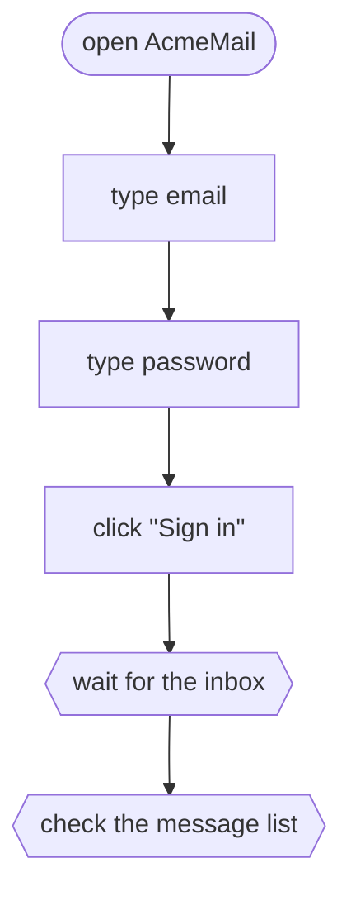

<p align="center">
  
</p>

<p align="center">
  <a href="LICENSE"></a>
  
  <a href="CONTRIBUTING.md"></a>
</p>

<p align="center">
  <b>Visual, flowchart-driven UI testing for any application.</b><br>
  Draw the path a user takes. JEVision walks it, block by block, and tells you where it broke.
</p>

---

## Why JEVision

UI tests usually live as long scripts that only their author can read. When one fails, you dig
through code to find out *which step* went wrong and *why*.

JEVision treats a test as what it really is — a **flowchart**:

- **One test, one file.** Each test is a self-contained JSON file. Easy to review, diff, share and version.
- **Blocks, not scripts.** Launch, click, type, wait, check, branch, loop — each step is a block you can see.
- **Readable by everyone.** QA, developers, designers and product people look at the same diagram.
- **Failures point at a block.** A red block on the chart beats a stack trace in a log.
- **Any app, not just yours.** Built to test interfaces you don't own and can't instrument.

## How it works

A test is a graph of blocks. Execution starts at `start` and follows the arrows.



The same test as a file — [`examples/sign-in.flow.json`](examples/sign-in.flow.json), shortened:

```json
{
  "format": 1,
  "name": "Sign in with valid credentials",
  "app": "com.example.AcmeMail",
  "start": "open",
  "blocks": {
    "open": { "type": "openApp", "next": "email" },
    "email": { "type": "type", "text": "demo@example.com", "into": { "image": "refs/email-field.png" }, "next": "password" },
    "password": { "type": "type", "text": "${secret.ACME_PASSWORD}", "into": { "image": "refs/password-field.png" }, "next": "submit" },
    "submit": { "type": "click", "target": { "image": "refs/sign-in-button.png" }, "button": "left", "next": "inbox" },
    "inbox": { "type": "waitFor", "until": { "appears": { "image": "refs/inbox.png" } }, "timeout": "10s", "next": "messages" },
    "messages": { "type": "check", "reference": { "image": "refs/message-list.png", "compare": "similar", "threshold": 0.9 } }
  }
}
```

- **`format`** is the file format version. Older files are upgraded when read; files from a newer
  JEVision are refused instead of being misread.
- **`app`** is the bundle identifier of the application under test.
- **Paths** (reference images, data files, other tests) are relative to the folder of the test file.
- **Secrets are never stored in the file.** `${secret.NAME}` refers to a secret by name; its value
  comes from the environment or the Keychain at run time. `${data.COLUMN}` is a value from the
  current row of a `useData` table. Both are allowed in the text of a `type` block.
- **Arrows** are `next`, `then`/`else` and `body`. A loop is only possible through the `body` of
  `repeat` or `useData`; any other cycle is an error.
- **Optional metadata:** `description`, `testType` (`smoke`, `regression`, `acceptance`),
  `priority` (`critical`, `high`, `medium`, `low`), `status` (`draft`, `ready`, `outdated`),
  `tags` and `retries`.

`jevision fmt` rewrites test files in canonical form (see [Command line](#command-line)). The canonical form has a fixed key order, lists blocks in reading order and leaves out default
values, so every change shows up as a small, readable diff.

## Block types

| Block | Group | What it does |
| --- | --- | --- |
| `openApp` | actions | Opens the application under test, or another one by bundle identifier |
| `openFile` | actions | Opens files or web addresses, optionally in a new instance of the application |
| `click` | actions | Clicks an image on screen or a point, left or right, single or double |
| `type` | actions | Types text, optionally into a field found by its image |
| `pressKeys` | actions | Presses a key combination such as `cmd+shift+s` |
| `waitFor` | wait and check | Waits until an image appears, disappears or the screen stops changing |
| `check` | wait and check | Compares the screen with a reference image: `exact`, `similar` or `meaning` |
| `if` | logic | Goes to `then` or `else` depending on what is on screen |
| `repeat` | logic | Runs its `body` a given number of times |
| `runTest` | logic | Runs another test file as a step |
| `useData` | data | Runs its `body` once for every row of a CSV file |

A reference can limit the comparison to an `area`, `ignore` regions that change on their own and
`hide` regions that must not appear in reports. Areas use fractions of the window, from 0 to 1.

## Command line

The `jevision` command runs and checks tests from Terminal, scripts and CI. It comes inside the
app: choose **JEVision → Install Command Line Tool…** and click **Install…**. macOS asks for an
administrator's password and links the tool into `/usr/local/bin`. Without a password, click
**Install Just for Me** to link it into `~/.local/bin` instead. The window shows whether the tool
is installed and which version.

```sh
jevision run tests/                       # run every *.flow.json in tests/ and save reports
jevision run tests/sign-in.flow.json --start-at submit
jevision run tests/ --junit junit.xml --html reports    # also save JUnit XML and HTML reports
jevision validate tests/                  # report errors and warnings (--json for machines)
jevision fmt tests/                       # rewrite files in canonical form (--check to only report)
```

`jevision help <command>` lists every option. Exit status: **0** means all tests passed (or all
files are valid and formatted). **1** means a test failed or was stopped, or a file has problems.
**2** means wrong arguments, a file that can't be read, or a Mac that can't run tests right now.

`jevision run` uses the real mouse, keyboard and screen. These requirements apply wherever it runs:

- **A logged-in user with an unlocked screen.** Tests can't run over SSH, as a system service or
  while the screen is locked. For unattended runs, keep the user logged in and turn off the
  automatic lock in System Settings → Lock Screen.
- **Screen Recording and Accessibility** for the app that starts `jevision`: Terminal, your
  editor or the CI agent. If one is missing, `jevision` names the program that needs it and the
  list in System Settings → Privacy & Security where to turn it on.
- **Secrets** (`${secret.NAME}`) come from the environment variable `NAME` or from the Keychain,
  where the app saves them. The first time `jevision` reads a Keychain secret, macOS may ask to
  allow it; choose Always Allow for unattended runs. Values are never printed.

Press Esc twice or Ctrl-C to stop a run. The stopped test is reported as cancelled.

### GitHub Actions

Hosted runners have no logged-in user, so use a
[self-hosted runner](https://docs.github.com/actions/hosting-your-own-runners) on a Mac.
Install it as a service with `./svc.sh install` while logged in as the user who runs the tests.
On macOS this makes a launch agent that runs in that user's session. Then allow Screen Recording
and Accessibility for the program that the first run names.

```yaml
jobs:
  ui-tests:
    runs-on: [self-hosted, macOS]
    steps:
      - uses: actions/checkout@v4
      - name: Run UI tests
        env:
          ACME_PASSWORD: ${{ secrets.ACME_PASSWORD }}
        run: jevision run tests --junit junit.xml --html reports
      - uses: actions/upload-artifact@v4
        if: always()
        with:
          name: ui-test-reports
          path: |
            junit.xml
            reports/
```

### On a schedule

Use a launch agent, not cron: cron jobs don't run in the user's session, so they can't see the
screen. Save the plist below as `~/Library/LaunchAgents/com.example.ui-tests.plist`. It runs the
tests every day at 03:00 and writes the output to a log:

```xml
<?xml version="1.0" encoding="UTF-8"?>
<!DOCTYPE plist PUBLIC "-//Apple//DTD PLIST 1.0//EN" "http://www.apple.com/DTDs/PropertyList-1.0.dtd">
<plist version="1.0">
<dict>
  <key>Label</key>
  <string>com.example.ui-tests</string>
  <key>ProgramArguments</key>
  <array>
    <string>/usr/local/bin/jevision</string>
    <string>run</string>
    <string>/Users/me/Projects/AcmeMail/tests</string>
  </array>
  <key>StartCalendarInterval</key>
  <dict>
    <key>Hour</key>
    <integer>3</integer>
    <key>Minute</key>
    <integer>0</integer>
  </dict>
  <key>StandardOutPath</key>
  <string>/Users/me/Library/Logs/ui-tests.log</string>
  <key>StandardErrorPath</key>
  <string>/Users/me/Library/Logs/ui-tests.log</string>
</dict>
</plist>
```

```sh
launchctl bootstrap gui/$(id -u) ~/Library/LaunchAgents/com.example.ui-tests.plist
```

Reports are saved in the project's `.jevision/runs` folder, where the app shows them in its run
history.

## Roadmap

- [ ] Test file format and JSON Schema
- [ ] Runner: execute a test file block by block
- [ ] Reports: highlight the failed block on the diagram
- [ ] Visual editor for building tests as flowcharts
- [ ] Reusable sub-flows and shared variables
- [ ] CI integration

## Project status

JEVision is in **early design**. The repository is open from day one so the format and the
architecture can be shaped together. Star or watch the repo to follow along.

## Contributing

Ideas, questions and pull requests are welcome. Start with [CONTRIBUTING.md](CONTRIBUTING.md)
and please follow the [Code of Conduct](CODE_OF_CONDUCT.md).
Security issues: see [SECURITY.md](SECURITY.md).

## License

[MIT](LICENSE)
