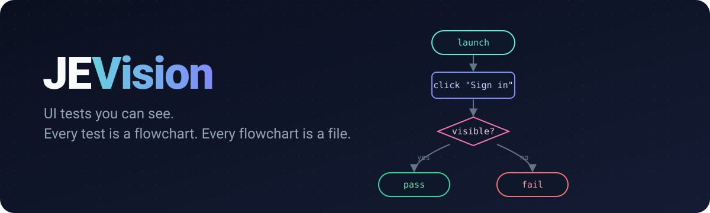
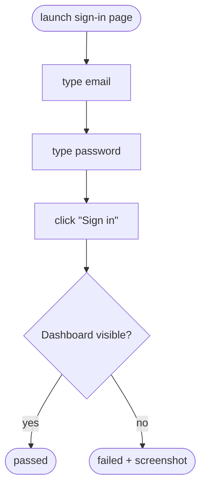

<p align="center">
  
</p>

<p align="center">
  <a href="LICENSE"></a>
  
  <a href="CONTRIBUTING.md"></a>
</p>

<p align="center">
  <b>Visual, flowchart-driven UI testing for any application.</b><br>
  Draw the path a user takes. JEVision walks it, block by block, and tells you where it broke.
</p>

---

## Why JEVision

UI tests usually live as long scripts that only their author can read. When one fails, you dig
through code to find out *which step* went wrong and *why*.

JEVision treats a test as what it really is — a **flowchart**:

- **One test, one file.** Each test is a self-contained JSON file. Easy to review, diff, share and version.
- **Blocks, not scripts.** Launch, click, type, wait, check, branch, loop — each step is a block you can see.
- **Readable by everyone.** QA, developers, designers and product people look at the same diagram.
- **Failures point at a block.** A red block on the chart beats a stack trace in a log.
- **Any app, not just yours.** Built to test interfaces you don't own and can't instrument.

## How it works

A test is a graph of blocks. Execution starts at `start` and follows the arrows.



The same test as a file — [`examples/sign-in.flow.json`](examples/sign-in.flow.json):

```json
{
  "name": "Sign in with valid credentials",
  "start": "open",
  "blocks": {
    "open":   { "type": "launch", "target": "https://example.com/sign-in", "next": "email" },
    "email":  { "type": "type",  "into": { "label": "Email" }, "text": "demo@example.com", "next": "password" },
    "password": { "type": "type", "into": { "label": "Password" }, "text": "${env.DEMO_PASSWORD}", "next": "submit" },
    "submit": { "type": "click", "on": { "role": "button", "name": "Sign in" }, "next": "check" },
    "check":  { "type": "if", "condition": { "visible": { "text": "Dashboard" } }, "then": "pass", "else": "fail" },
    "pass":   { "type": "end", "result": "passed" },
    "fail":   { "type": "end", "result": "failed", "screenshot": true }
  }
}
```

> [!NOTE]
> The file format is a **draft** and will change. Feedback is very welcome in
> [Discussions](../../discussions).

## Block types (planned)

| Block | Shape | What it does |
| --- | --- | --- |
| `launch` | start | Opens the application or page under test |
| `click`, `type`, `select`, `scroll` | step | Interacts with the interface |
| `wait` | step | Waits for an element, a state or a time |
| `if` | decision | Branches on what is on screen |
| `loop` | decision | Repeats a group of blocks |
| `call` | subprocess | Runs another test file as a reusable block |
| `end` | finish | Ends the run as passed or failed |

## Roadmap

- [ ] Test file format and JSON Schema
- [ ] Runner: execute a test file block by block
- [ ] Reports: highlight the failed block on the diagram
- [ ] Visual editor for building tests as flowcharts
- [ ] Reusable sub-flows and shared variables
- [ ] CI integration

## Project status

JEVision is in **early design**. The repository is open from day one so the format and the
architecture can be shaped together. Star or watch the repo to follow along.

## Contributing

Ideas, questions and pull requests are welcome. Start with [CONTRIBUTING.md](CONTRIBUTING.md)
and please follow the [Code of Conduct](CODE_OF_CONDUCT.md).
Security issues: see [SECURITY.md](SECURITY.md).

## License

[MIT](LICENSE)
