<p align="center">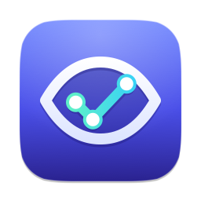</p>
<h1 align="center">JEVision</h1>
<p align="center"><b>UI tests you can see.</b><br>Draw the path a user takes through any Mac app. JEVision walks it block by block and shows where it broke.</p>
<p align="center"><sub><b>English</b> · <a href="docs/readme/README.ru.md">Русский</a></sub></p>

<p align="center">
<picture>
<source media="(prefers-color-scheme: dark)" srcset="docs/media/hero-dark.png">
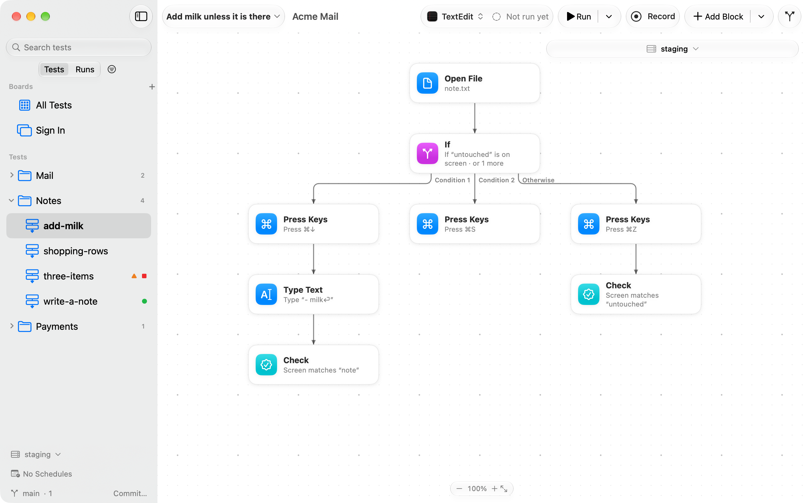
</picture>
</p>

JEVision tests the interface of any Mac app, including apps you don't own and can't instrument.
It sees the screen and uses the real mouse and keyboard, the way a person does. A test is a
flowchart: one JSON file per test, with a block for every step, so anyone on the team can read
it and a failure points at the block where it happened.

## Get JEVision

JEVision needs macOS 26 or later, on Apple silicon or Intel. Until the first release, build it
from source with Xcode 26 or later and Rust 1.85 or later, installed with
[rustup](https://rustup.rs):

```sh
git clone https://github.com/dev-pikapik/JEVision.git
cd JEVision
apps/macos/scripts/build.sh
open apps/macos/build/JEVision.app
```

`build.sh` builds the Rust core for both architectures, then the app and the `jevision` tool
into `apps/macos/build/JEVision.app`. Set `ARCHS=arm64` to build for one architecture only, and
`SIGN_IDENTITY` to sign with your own certificate instead of an ad-hoc signature.

## What it does

<table>
<tbody><tr>
<td width="50%" valign="top">
<picture><source media="(prefers-color-scheme: dark)" srcset="docs/media/editor-dark.png">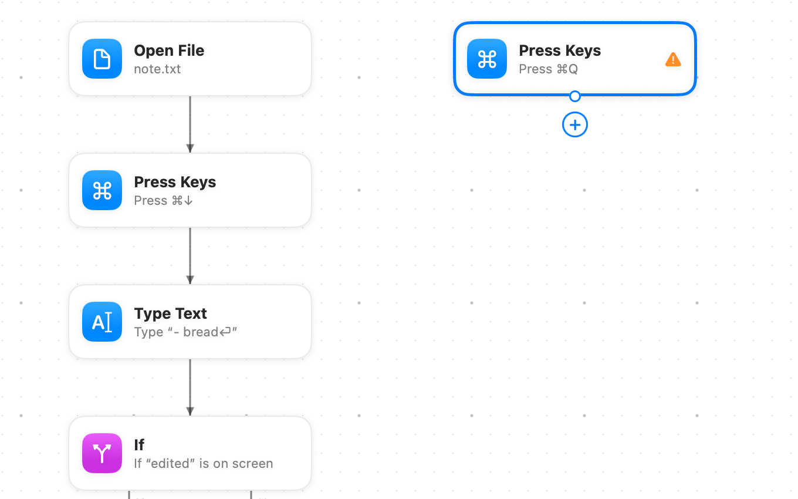</picture>
<br><b>Built from simple blocks</b>
<br>Press Space for the block library: every block with its icon and one line on what it does. Right-click the canvas to put a block right there.
</td>
<td width="50%" valign="top">
<picture><source media="(prefers-color-scheme: dark)" srcset="docs/media/branches-dark.png">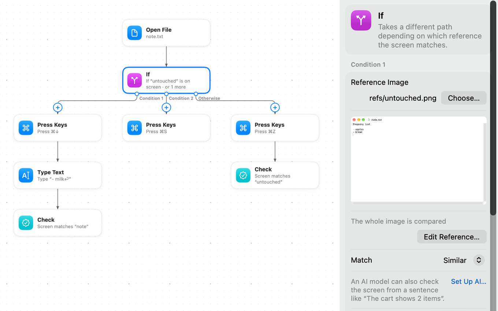</picture>
<br><b>Several ways out</b>
<br>An If checks several conditions in order. The first one the screen matches wins, and Otherwise takes the rest.
</td>
</tr></tbody>
<tbody><tr>
<td width="50%" valign="top">
<picture><source media="(prefers-color-scheme: dark)" srcset="docs/media/command-palette-dark.png">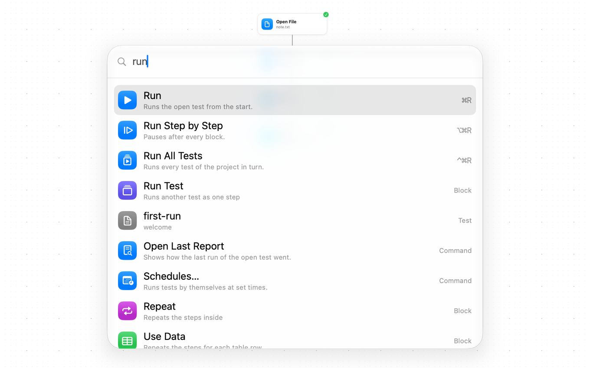</picture>
<br><b>Everything one ⌘K away</b>
<br>Type a few letters of any command, block or test and press Return.
</td>
<td width="50%" valign="top">
<picture><source media="(prefers-color-scheme: dark)" srcset="docs/media/report-dark.png">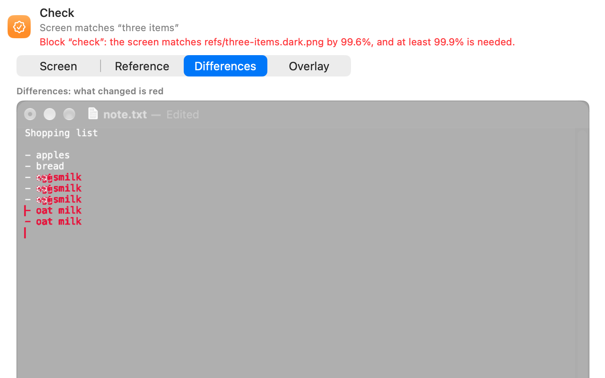</picture>
<br><b>See what broke</b>
<br>Every run keeps a screenshot of each step. A check shows the screen next to its reference, one over the other, or just the pixels that differ.
</td>
</tr></tbody>
<tbody><tr>
<td width="50%" valign="top">
<picture><source media="(prefers-color-scheme: dark)" srcset="docs/media/history-dark.png">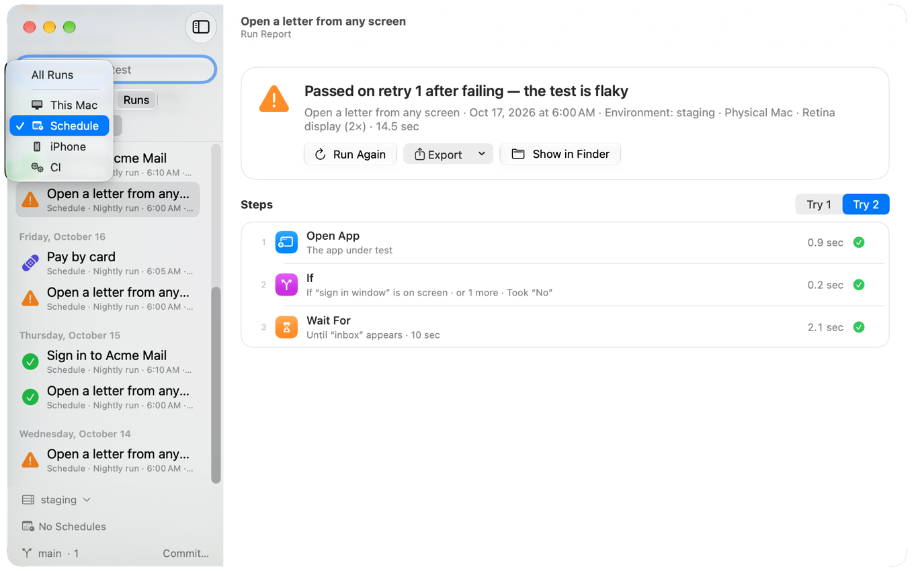</picture>
<br><b>Run all, keep the history</b>
<br>Run every test of a project at once. The history shows what passed, what failed and which tests are flaky, with the evidence.
</td>
<td width="50%" valign="top">
<picture><source media="(prefers-color-scheme: dark)" srcset="docs/media/ai-check-dark.png">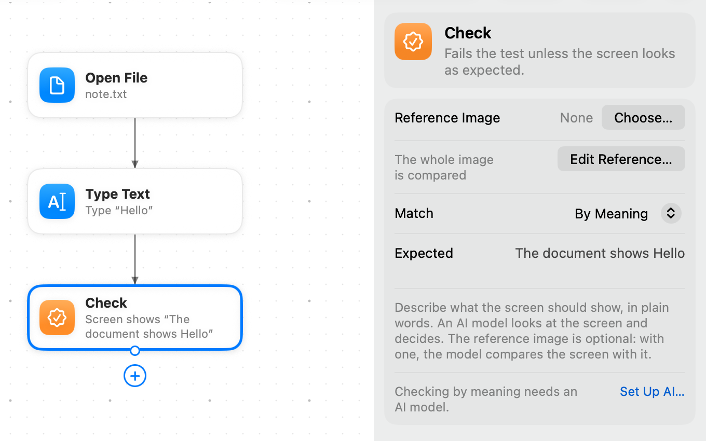</picture>
<br><b>Checks by meaning</b>
<br>Where pictures are too strict, describe the screen in words, such as “The cart shows 2 items”, and an AI model of your choice decides.
</td>
</tr></tbody>
<tbody><tr>
<td width="50%" valign="top">
<picture><source media="(prefers-color-scheme: dark)" srcset="docs/media/git-dark.png">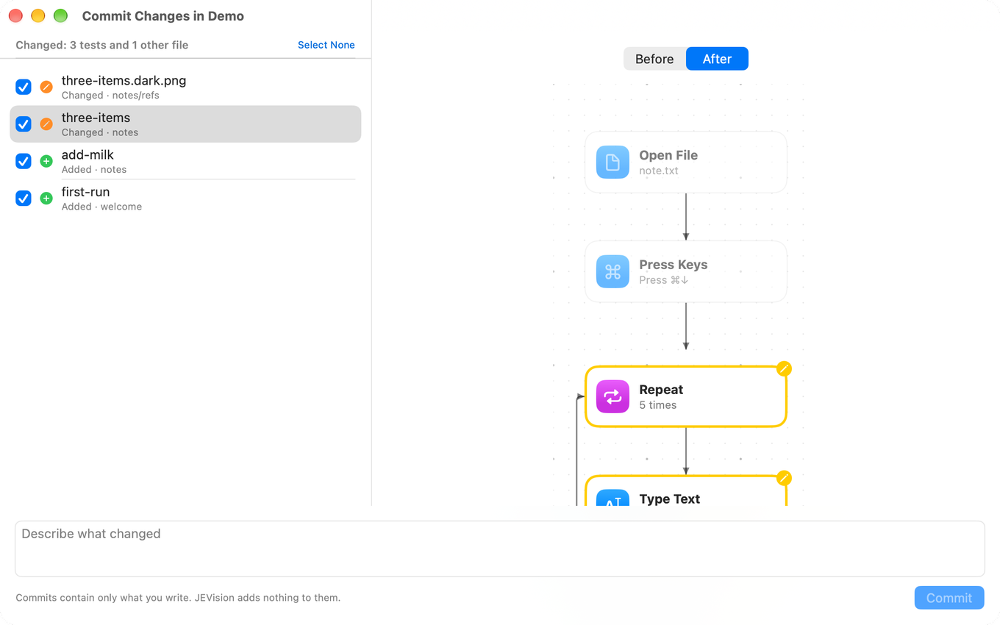</picture>
<br><b>Git without a terminal</b>
<br>Commit with ⌥⌘C and open a pull request with ⌥⌘P. A changed test shows as one flowchart with its added, removed and changed blocks.
</td>
<td width="50%" valign="top">
<picture><source media="(prefers-color-scheme: dark)" srcset="docs/media/schedule-dark.png">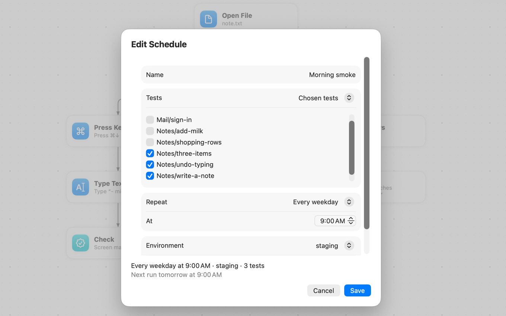</picture>
<br><b>Runs on a schedule</b>
<br>Every night, on weekdays or every few hours, with the environment you choose. A failed run sends a notification, and a message to Slack, Telegram or email if you set one up.
</td>
</tr></tbody>
<tbody><tr>
<td width="50%" valign="top">
<picture><source media="(prefers-color-scheme: dark)" srcset="docs/media/project-map-dark.png">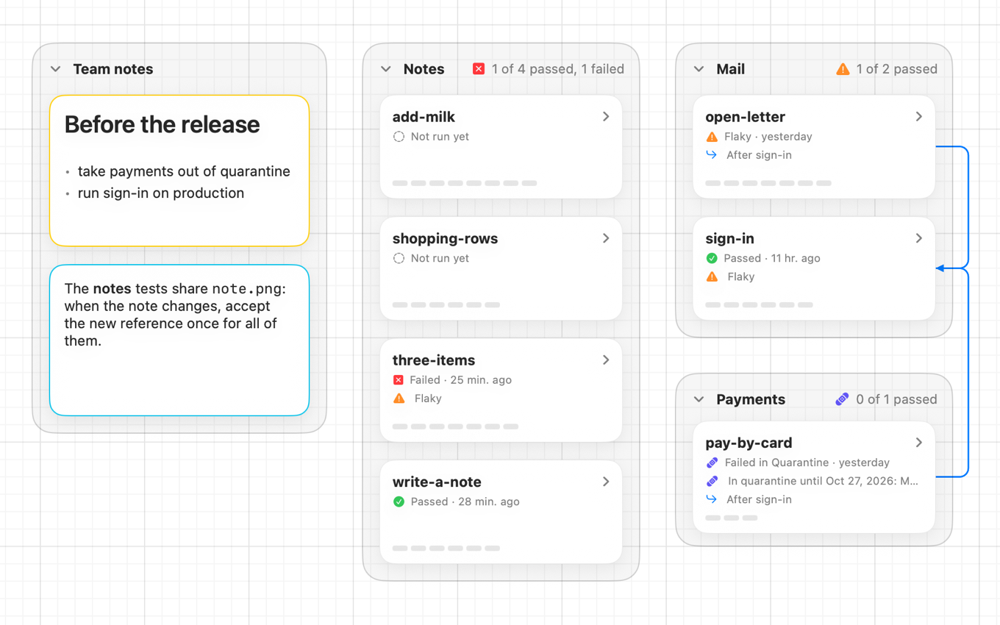</picture>
<br><b>Project map</b>
<br>Every test of the project on one page, with its last result, flaky tests and tests in quarantine.
</td>
<td width="50%" valign="top">
<picture><source media="(prefers-color-scheme: dark)" srcset="docs/media/iphone-dark.png">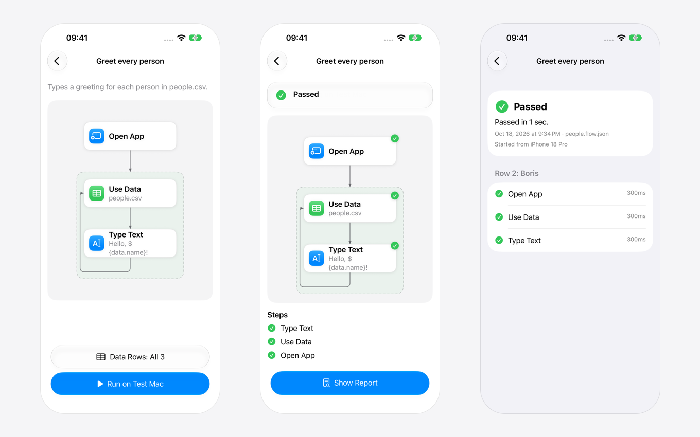</picture>
<br><b>iPhone remote</b>
<br>Pair an iPhone, start a test or one row of its data, and follow the run block by block. Tests and pictures stay on the Mac.
</td>
</tr></tbody>
</table>

Also: the [`jevision` command line](#command-line) for Terminal and CI,
[AI assistants over MCP](#assistants-mcp), [data-driven tests](#data-driven-tests) from CSV files,
[environments](#environments), [custom blocks](#custom-blocks) to share and install, and runs [in a virtual machine](#in-a-virtual-machine).

## First steps

1. **Open Project…** (⌘O) and choose a folder. Tests are the `*.flow.json` files in it; a
   folder per application works well.
2. **New Test…** (⌘N), give it a name and choose the application to test.
3. **Record** (⇧⌘R), then use the app. Press Esc twice or click **Done** to finish; the steps
   appear on the canvas.
4. **Run** (⌘R). The app under test comes to the front and JEVision repeats the steps. When the
   run ends, open its report to see each step with screenshots.

⌘K opens the command palette: type a few letters of any command, block or test and press Return.

## Details

<a id="permissions"></a>
<details>
<summary><b>Permissions</b></summary>

JEVision asks for two permissions in System Settings → Privacy & Security, and explains each
before asking:

- **Screen & System Audio Recording**, to take screenshots of the app under test: finding what
  to click, waiting for screens and comparing them with reference images.
- **Accessibility** (called **Device Control and Data Access** from macOS 27), to click, type and press keys for you; to read the names of controls while
  recording, so blocks and pictures get readable names; and to notice your own mouse and keyboard,
  so a run pauses when you take over.

Settings → Permissions shows what is granted and opens the right page in System Settings.

</details>

<a id="how-it-works"></a>
<details>
<summary><b>How a test is written</b></summary>

A test is a graph of blocks. Execution starts at `start` and follows the arrows.


The same test as a file — [`examples/sign-in.flow.json`](examples/sign-in.flow.json), shortened:

```json
{
  "format": 1,
  "name": "Sign in with valid credentials",
  "app": "com.example.AcmeMail",
  "start": "open",
  "blocks": {
    "open": { "type": "openApp", "next": "email" },
    "email": { "type": "type", "text": "demo@example.com", "into": { "image": "refs/email-field.png" }, "next": "password" },
    "password": { "type": "type", "text": "${secret.ACME_PASSWORD}", "into": { "image": "refs/password-field.png" }, "next": "submit" },
    "submit": { "type": "click", "target": { "image": "refs/sign-in-button.png" }, "button": "left", "next": "inbox" },
    "inbox": { "type": "waitFor", "until": { "appears": { "image": "refs/inbox.png" } }, "timeout": "10s", "next": "messages" },
    "messages": { "type": "check", "reference": { "image": "refs/message-list.png", "compare": "similar", "threshold": 0.9 } }
  }
}
```

- **`format`** is the file format version. Older files are upgraded when read; files from a newer
  JEVision are refused instead of being misread.
- **`app`** is the bundle identifier of the application under test.
- **Paths** (reference images, data files, other tests) are relative to the folder of the test file.
- **Secrets are never stored in the file.** `${secret.NAME}` refers to a secret by name; its value
  comes from the environment or the Keychain at run time. `${env.NAME}` is a value of the chosen
  environment (see below). `${data.COLUMN}` is a value from the current row of a `useData` table.
  All three are allowed in the text of a `type` block.
- **Arrows** are `next`, `then`/`elseIf1`…/`else` and `body`. A loop is only possible through the `body` of
  `repeat` or `useData`; any other cycle is an error.
- **Optional metadata** (the test card): `description`, `testType` (`smoke`, `regression`,
  `acceptance`), `priority` (`critical`, `high`, `medium`, `low`), `status` (`draft`, `ready`,
  `outdated`), `tags`, `preconditions`, `author`, `platform`, `link` (web address of the issue
  or requirement, starting with `https://`), `flaky` (`true` marks a test that sometimes fails
  for reasons outside the app) and `retries` (how many more times to run the test when it fails;
  without it, the project's default applies, see below).
- **`canvas`** (optional) keeps how the test looks in the editor: `positions` of blocks moved by
  hand, `sections` (titled frames around a part of the test) and `notes` (Markdown text with its
  author, time and frame; optionally what it is about — the test, a folder or a block —, attached
  files and links, replies and a resolved mark). It never changes how the test runs; without it
  the blocks are laid out automatically. Files of notes live in `<test>.assets/notes/<note id>/`
  next to the test.

</details>

<a id="environments"></a>
<details>
<summary><b>Environments</b></summary>

One test can run against staging, production or a local server. Values that differ between them,
such as a server address or a user name, go into `jevision.environments.json` in the project
folder, next to the tests, and are committed with them:

```json
{
  "format": 1,
  "default": "staging",
  "environments": {
    "production": { "BASE_URL": "https://example.com" },
    "staging": { "BASE_URL": "https://staging.example.com", "USER": "qa" }
  }
}
```

- Environment names use letters, digits, `-` and `_`; value names use letters, digits and `_`.
- `default` is optional and must name one of the environments. `jevision run` without `--env`,
  and an assistant's run without `env`, use it; the app picks it until you choose another one.
- A test reads a value as `${env.BASE_URL}`, in text to type and in the paths and addresses of
  files a block opens or reads (`${secret.NAME}` and `${data.COLUMN}` work there too).
  `jevision validate` and the editor report a name no environment has as an error, and a name
  only some environments have as a warning.
- The file is never for secrets. A secret can still differ per environment: the app saves it in
  the Keychain for the environment chosen when you set it. At run time a secret comes from the
  environment variable `NAME`, then from the Keychain item of the chosen environment, then from
  the one shared by all environments.
- In the app, pick the environment at the foot of the sidebar or in the Run menu, which also
  picks one data row (or all of them) and the number of retries for the next runs. The choice of
  environment is kept per project on this Mac. Before a run the app lists the names of missing
  values and secrets, never the values. The report says which environment the run used.

</details>

<a id="data-driven-tests"></a>
<details>
<summary><b>Data-driven tests</b></summary>

One test can run with many sets of values, such as several users or languages. Put the values in
a CSV file next to the test, one row per set and one column per value, and read it with a
`useData` block; a block after it reads the current row's value as `${data.COLUMN}`:

```csv
name,email,password
Anna,anna@example.com,first-try
Bo,bo@example.com,"quotes ""inside"", and a comma"
```

- **Once per row.** The first `useData` block on the way from `start` names the test's table:
  the whole test runs once for each of its rows, and every block of the test reads that row's
  values. Each row is a result of its own, with its own retries, named by its `name` column (any
  case), or else by its first column, like "Row 2: Bo". The run passes when every row passes,
  and the report and the run summary say how many did, like "4 of 5 rows passed". In JUnit XML
  each row is a test case of its own, like `Sign in [Row 2: Bo]`. A table whose path holds a
  placeholder, and any further `useData` block, loops through its rows inside the run instead.
- **Choosing rows.** All rows run by default. Run one row or a range with
  `jevision run --row 3` or `--rows 2-4`, the Run menu in the app, or `rows` of an assistant's
  `run_test`. Rows count from 1; the header line isn't a row. A row the table doesn't have stops
  the run before it starts.
- **CSV rules** ([RFC 4180](https://www.rfc-editor.org/rfc/rfc4180)). The first line names the
  columns: every name must be filled in and different from the others. Values are separated by
  `,`, `;` or a tab, whichever the first line uses most. A value with the separator, a quote or
  a line break goes in double quotes, with a quote inside written twice (`""`). Every line has
  as many values as the header; a value may be empty. Blank lines are skipped. The file is UTF-8,
  with or without a byte order mark, with LF or CR LF line ends.
- **Checks.** `jevision validate` and the editor report a table that breaks these rules, with
  the line where it goes wrong, and a `${data.COLUMN}` that the table doesn't have, with the
  columns it does have.
- **Editing.** In the app, select the `useData` block and click **Edit Data…** to view the table,
  change cells, and add or remove rows and columns. Saving keeps the file's separator, line ends
  and byte order mark.

</details>

<a id="retries-flaky-tests-and-quarantine"></a>
<details>
<summary><b>Retries, flaky tests and quarantine</b></summary>

Settings shared by every test of a project go into `jevision.project.json` in the project folder,
committed with the tests. The app writes it in Settings › Advanced and from the sidebar; the file
is optional:

```json
{
  "format": 1,
  "retries": 2,
  "quarantine": [
    { "test": "checkout/pay.flow.json", "reason": "Payment sandbox is down, issue #42", "until": "2026-11-03" }
  ],
  "suggestQuarantineAfter": 3,
  "localOnly": true,
  "hide": [{ "x": 0.7, "y": 0, "width": 0.3, "height": 0.08 }]
}
```

- **Retries.** A failed test runs again up to its number of retries: `jevision run --retries`
  first, then the test's own `retries`, then the project's `retries`, otherwise none. At most 10.
- **Verdict.** Every run says how its retries went: passed on retry after failing (the test is
  flaky), failed each time differently (it may be flaky), or failed every time in a row (a real
  failure, not flakiness). The report, the app and `jevision run` show this line.
- **Flaky from history.** When the same test file, unchanged since (same content hash), both
  passed and failed in the same environment over the last 30 days, the app marks it flaky in the
  sidebar, the project map and the run history, with the dates and counts as evidence. A
  data-driven test is judged row by row: reports keep which row ran (number, label and a
  fingerprint of its values, never the values), so a row that fails now and then is flaky and the
  others aren't.
- **Quarantine suggestion.** A run is unreliable when it passed only on a retry, or failed after
  the same unchanged test had passed (a string of failures counts once). A test, or a data row,
  that was unreliable 3 times in 7 days gets a mark in the sidebar; its details list those runs,
  each a link to its report, and one button puts it in quarantine for 14 days. Change the number
  with `suggestQuarantineAfter` (1 to 10) or in Settings › Advanced.
- **Quarantine.** `quarantine` lists tests, by path relative to the project folder, whose failures
  shouldn't block anyone while they are fixed. They still run and their reports show the failure,
  but a failure doesn't fail Run All or the `jevision run` exit status, and the JUnit report lists
  it as skipped with the reason and the failure. `reason` is optional. `until` is the last day,
  `YYYY-MM-DD`: the app offers 14 days, you can pick another or none. The next day the test counts
  again by itself, with nothing to edit. The sidebar, the project map and the reports mark these
  tests ("in quarantine until Nov 3"). To put a test in quarantine or release it, use its menu
  in the sidebar, the test's details, or Settings › Advanced. `jevision run
  --include-quarantined-failures` counts their failures like any other, for example in a nightly
  build.
- **Only models on this Mac.** `localOnly: true` keeps the project's screenshots on the Mac for
  everyone who runs its tests, whatever their own settings: checks by meaning work with local
  models only and assistants get no screenshots. Set it in Settings → AI.
- **Areas always hidden.** `hide` lists parts of the window, in fractions from 0 to 1 like the
  areas of a block, painted over in every screenshot of the project before it goes to an AI model
  or an assistant, for example an account name in the corner of every screen.

`jevision fmt` rewrites test files in canonical form (see [Command line](#command-line)). The canonical form has a fixed key order, lists blocks in reading order, leaves out settings that
are off or empty and always writes the click `button`, the reference's `compare` (with its
`threshold` for `similar`) and the `waitFor` `timeout`, so every change shows up as a small,
readable diff.

</details>

<a id="block-types"></a>
<details>
<summary><b>Block types</b></summary>

| Block | Group | What it does |
| --- | --- | --- |
| `openApp` | actions | Opens the application under test, or another one by bundle identifier |
| `openFile` | actions | Opens files or web addresses, optionally in a new instance of the application |
| `click` | actions | Clicks an image on screen, an element described in words (found by JEV), a point or the middle of an `area`, with the left, right or middle button, single or double, optionally holding ⌃ ⌥ ⇧ ⌘ (`"modifiers": ["cmd"]`); with `"waitForChange": true` it then waits up to 10 seconds for the screen to change and fails if it doesn't |
| `hover` | actions | Moves the pointer onto an image on screen, an element described in words, a point or an area and leaves it there, to show a tooltip or a menu that opens on hover, optionally holding ⌃ ⌥ ⇧ ⌘ (`modifiers`) |
| `drag` | actions | Presses the left, right or middle `button` `from` one image, described element, point or area, moves holding it and lets go `to` another, optionally holding ⌃ ⌥ ⇧ ⌘ (`modifiers`) |
| `scroll` | actions | Turns the scroll wheel `up`, `down`, `left` or `right` by an `amount` of `lines` or `pixels`, over the middle of the window or `at` an image, described element, point or area, optionally holding ⌃ ⌥ ⇧ ⌘ (`"modifiers": ["cmd"]` zooms in most apps) |
| `type` | actions | Types text, optionally into a field found by its image or description |
| `pressKeys` | actions | Presses a key combination such as `cmd+shift+s` |
| `waitFor` | wait and check | Waits until an image appears, disappears or the screen stops changing |
| `check` | wait and check | Compares the screen with a reference image, exactly or by similarity, or checks it by meaning |
| `if` | logic | Goes to `then`, to the first matching `elseIf` condition, or to `else`, depending on what is on screen |
| `repeat` | logic | Runs its `body` a given number of times |
| `runTest` | logic | Runs another test file or a [custom block](#custom-blocks) as a step; its `inputs` give values to `${input.NAME}` in that test |
| `useData` | data | Runs its `body` with the rows of a CSV file (see [Data-driven tests](#data-driven-tests)) |
| `script` | data and system | Runs a `sh`, `zsh`, Python 3, Node or AppleScript script; its `inputs` are text, number, boolean, image (a PNG file) or area (`x,y,width,height` in fractions of the window), and its `outputs` become `${var.NAME}` of the same types; a value that doesn't fit its type is reported while editing |
| `clipboard` | data and system | Puts text or a PNG picture on the clipboard (`put`), keeps its text, its picture (`"content": "image"`) or the copied files (`"content": "files"`) as a variable (`read`) or waits until it equals, contains or compares with a value (`check`); a test with it doesn't run beside another that uses the screen |
| `dateTime` | data and system | Keeps the current date and time, written as a `strftime` `format` and moved by a `shift` such as `{ "amount": -2, "unit": "days" }`, as `${var.NAME}`; month and day names in English or Russian (`language`), in the Mac's time zone or another (`"timeZone": "Europe/Berlin"`) |

A reference can limit the comparison to an `area`, `ignore` regions that change on their own and
`hide` regions that must not appear in reports. Areas use fractions of the window, from 0 to 1.

When the app under test is drawn in dark appearance, a run uses the dark version of a picture,
named with `.dark` before the extension: `refs/inbox.dark.png` for `refs/inbox.png`. A `check`
saves it on its first dark run, like any new reference; `waitFor`, `if` and click targets use it
when it exists and the light picture otherwise. The test file names only the light picture.

With `"compare": "meaning"`, an AI model looks at the screen and decides whether it shows what
`expect` says, in plain words: `{ "compare": "meaning", "expect": "The cart shows 2 items" }`.
The reference image is optional; with one, the model compares the screen with it. `check`,
`waitFor` and `if` all accept such a reference.

</details>

<a id="custom-blocks"></a>
<details>
<summary><b>Custom blocks</b></summary>

A custom block is a test that other tests run with `runTest`. Values come in through `inputs` and
the block reads them as `${input.NAME}`. Select blocks on the canvas and choose **Make Block…** to
make one; it lives in `blocks/` of the project and joins the block library.

To share one, choose **File → Custom Blocks…**, then **Share…** next to the block. JEVision writes a
package: a folder `com.author.name.jevblock/` with a `block.json` (id, name, description, icon,
version, author, license, the inputs it asks for) and a `flow.json` with the steps, and the pictures
they use, as a folder or a .zip file. Put it in a GitHub repository or release for others.

To use one, choose **File → Install Block…**, drop a folder or a .zip file on the window, or paste an
https address; a folder, repository or release with several blocks shows them as a list to pick
from. Before anything is installed, a sheet says what the block does in plain words, and
marks scripts, network requests, database queries, opened applications and typed keys, so you know
what you let into your project. Installed blocks appear in the library under **Community** with
their author and version, and reports name the package and its version. **Update** fetches the
newest version of a block installed from an address, and **Remove** names the tests that still use a
block instead of removing it behind their back. A block can run other blocks it lists under
`dependencies`, and those are installed first. Installed blocks are read-only; **Make this a block of
the project** copies one into your own blocks to change it. Opening a project offers to install the
blocks its `jevision.blocks.json` lists and the Mac lacks. A test that uses a block you haven't installed names
it with its version and offers **Install…** right in the error; `jevision validate` and `jevision run`
print the same message with the `jevision blocks install` command.

```sh
jevision blocks list                      # the blocks installed in the project
jevision blocks install ./sign-in.zip     # show what the block does; add --yes to install it
jevision blocks install https://github.com/acme/sign-in --yes
jevision blocks update                    # newest version of every block installed from an address
jevision blocks remove com.acme.sign-in   # --force when tests use it
jevision blocks restore --yes             # install what jevision.blocks.json lists and the project lacks
```

Installing never runs anything and unpacking never leaves the project's folder. The format is in
[docs/custom-blocks.html](docs/custom-blocks.html); an example package is in
[examples/textedit/blocks](examples/textedit/blocks).

</details>

<a id="ai-models"></a>
<details>
<summary><b>AI models</b></summary>

Checks by meaning use the model chosen in Settings → AI. Without one, JEVision compares pictures
only and sends nothing anywhere.

| Provider | Runs | API key |
|---|---|---|
| Anthropic | in the cloud | `ANTHROPIC_API_KEY` |
| OpenAI | in the cloud | `OPENAI_API_KEY` |
| Google Gemini | in the cloud | `GEMINI_API_KEY` |
| JEV (TypeSafe AI) | in the cloud | `TYPESAFE_API_KEY` |
| Ollama | on this Mac | none |
| LM Studio | on this Mac | none |
| OpenAI-compatible server | at the address you give | `OPENAI_COMPATIBLE_API_KEY`, if the server asks for one |

- **What is sent.** For each check by meaning: the compared part of the screen, the reference
  image if there is one, and the expected text. For each element a test describes in words: the
  window screenshot and the description, to JEV. Nothing else is sent.
- **Finding by description.** A `click`, `hover`, `drag`, `scroll` or `type` can target an element
  described in words, like `{ "description": "the blue Save button" }`. JEV finds it on the masked
  screenshot and the report outlines where, so JEV
  must be set up here even when another provider checks by meaning; it needs model jev-1.14.0 or
  newer, or jev-latest.
- **Masking.** Before a picture leaves the Mac, solid grey blocks cover the regions the reference
  hides or ignores, the project's `hide` areas and every password field the Accessibility
  permission lets JEVision find. The report shows the picture exactly as it was sent, marked
  "masked before sending". The same masking applies to screenshots given to assistants.
- **API keys** come from the environment variable in the table or from the Keychain, where
  Settings → AI saves them. They are never shown, logged or written to reports.
- **Only models on this Mac.** With this setting on, screenshots never go to a cloud service:
  a check that would need one stops with a message. A project can require it for everyone with
  `localOnly` in `jevision.project.json`.
- **Reports** keep the provider, the model and its explanation for each check by meaning.
- **Test Connection** in Settings asks the model about a small built-in picture, to check the
  address, key and model in one go.

</details>

<a id="command-line"></a>
<details>
<summary><b>Command line</b></summary>

The `jevision` command runs and checks tests from Terminal, scripts and CI. It comes inside the
app: choose **JEVision → Install Command Line Tool…** and click **Install…**. macOS asks for an
administrator's password and links the tool into `/usr/local/bin`. Without a password, click
**Install Just for Me** to link it into `~/.local/bin` instead. The window shows whether the tool
is installed and which version.

```sh
jevision run tests/                       # run every *.flow.json in tests/ and save reports
jevision run tests/sign-in.flow.json --start-at submit
jevision run tests/ --project ~/ui-tests  # project folder (default: nearest folder with .jevision)
jevision run tests/ --retries 2           # run a failed test up to 2 more times
jevision run tests/ --env staging         # read ${env.NAME} from the staging environment
jevision run tests/sign-in.flow.json --rows 2-4   # only rows 2 to 4 of its data table (--row 3 for one)
jevision run tests/ --junit junit.xml --html reports    # also save JUnit XML and HTML reports
jevision run tests/ --video always        # record a video of every run (off, on-failure, always)
jevision run tests/ --parallel 4          # up to 4 tests at once; those using the screen still take turns
jevision run tests/ --include-quarantined-failures   # failures of tests in quarantine count too
jevision run tests/ --priority critical --type smoke  # only tests whose card says so (--status, --author, --flaky too)
jevision run tests/ --no-notify           # don't send the Slack, Telegram or email message
jevision run tests/ --provider ollama --model qwen2.5vl:7b   # check by meaning with another model
jevision run tests/ --json                # print results as JSON; progress goes to standard error
jevision validate tests/                  # report errors and warnings (--json for machines)
jevision fmt tests/                       # rewrite files in canonical form (--check to only report)
jevision check                            # the project carries every file its tests read (--json too)
jevision blocks list                      # the custom blocks installed in the project (install, update, remove too)
jevision schedule run ~/Projects/AcmeMail # run the schedules of a project that are due now
jevision --version                        # print the version (-V for short)
jevision version --json                   # the version, file formats and protocols it supports, as JSON
```

`jevision help <command>` lists every option. Exit status: **0** means all tests passed (or all
files are valid and formatted); tests in quarantine may have failed (see
[Retries, flaky tests and quarantine](#retries-flaky-tests-and-quarantine)). **1** means a test failed or was stopped, or a file has problems.
**2** means wrong arguments, **3** a file that can't be read or written, **4** a Mac that can't run tests
right now, **5** a file that needs a newer JEVision. Every `--json` result starts with `"jsonVersion": 1`.

`jevision run` uses the real mouse, keyboard and screen. These requirements apply wherever it runs:

- **A logged-in user with an unlocked screen.** Tests can't run as a system service or while the
  screen is locked. Over SSH they run only as the user logged in at the screen, with the
  permissions below given to `/usr/libexec/sshd-session` (see [In a virtual machine](#in-a-virtual-machine)). For unattended runs, keep the user logged in and turn off the
  automatic lock in System Settings → Lock Screen.
- **Screen & System Audio Recording and Accessibility** (Device Control and Data Access from
  macOS 27) for the app that starts `jevision`: Terminal, your
  editor or the CI agent. If one is missing, `jevision` names the program that needs it and the
  list in System Settings → Privacy & Security where to turn it on.
- **Secrets** (`${secret.NAME}`) come from the environment variable `NAME` or from the Keychain,
  where the app saves them. The first time `jevision` reads a Keychain secret, macOS may ask to
  allow it; choose Always Allow for unattended runs. Values are never printed. With `--env`, the
  Keychain item of that environment comes first (see [Environments](#environments)).
- **AI models** for checks by meaning are the ones chosen in the app's Settings → AI, unless
  `--provider` and `--model` say otherwise. API keys come from the same environment variables or
  the Keychain.

Press Esc twice or Ctrl-C to stop a run. The stopped test is reported as cancelled.

</details>

<a id="github-actions"></a>
<details>
<summary><b>GitHub Actions</b></summary>

Hosted runners have no logged-in user, so use a
[self-hosted runner](https://docs.github.com/actions/hosting-your-own-runners) on a Mac.
Install it as a service with `./svc.sh install` while logged in as the user who runs the tests.
On macOS this makes a launch agent that runs in that user's session. Then allow Screen & System
Audio Recording and Accessibility (Device Control and Data Access from macOS 27) for the program
that the first run names.

```yaml
jobs:
  ui-tests:
    runs-on: [self-hosted, macOS]
    steps:
      - uses: actions/checkout@v4
      - name: Restore the last result of each test
        uses: actions/cache/restore@v4
        with:
          path: |
            tests/.jevision/last-results.json
          key: jevision-last-results-${{ github.run_id }}-${{ github.run_attempt }}
          restore-keys: jevision-last-results-
      - name: Check the project carries its files
        run: jevision check tests
      - name: Run UI tests
        env:
          ACME_PASSWORD: ${{ secrets.ACME_PASSWORD }}
        run: jevision run --project tests tests --junit junit.xml --html reports
      - name: Save the last result of each test
        if: always()
        uses: actions/cache/save@v4
        with:
          path: |
            tests/.jevision/last-results.json
          key: jevision-last-results-${{ github.run_id }}-${{ github.run_attempt }}
      - uses: actions/upload-artifact@v4
        if: always()
        with:
          name: jevision-reports
          include-hidden-files: true
          overwrite: true
          path: |
            junit.xml
            reports/
            tests/.jevision/runs/
```

You don't have to type it: **Settings › Advanced › Continuous Integration › Add to Project…**
shows this file for the open project, with the secrets your tests use, and writes it as
`.github/workflows/jevision.yml` at the top of the git repository the project is in. The preview
comes first, and an existing file is replaced only after you confirm. Nothing is committed or
pushed.

The two cache steps carry `.jevision/last-results.json`, the last result of each test, from one
run to the next. A fresh checkout has no run history, and without the file every failure would look
new to [notifications](#notifications) and no test would ever be reported fixed. `--project tests`
keeps the run's results in `tests/.jevision`, where the cache and the artifact look: a fresh
checkout has no `.jevision` folder yet to show where the project starts. A pull request can't see
the results another one kept, so its first run starts without any unless the workflow also runs on
your default branch; see
[Keeping the last results between CI runs](docs/notifications.html#last-results), also for GitLab
CI, Jenkins, Buildkite and other systems.

The artifact `jevision-reports` also carries the run reports with their screenshots. Once you are
signed in to GitHub (Settings › Git and GitHub) and the project's repository is on GitHub, the
app fetches the newest ones each time you open **Runs**, and with the refresh button there, and
adds them to the history, each once. A run from CI is marked “CI · pull request #482” or “CI ·
branch main”, its report links to the run on GitHub, and the filter above the list shows only
those. Without a sign-in nothing is fetched and the list says so. Artifacts made by an older
workflow, which had no run reports, need the workflow added again.

</details>

<a id="on-a-schedule"></a>
<details>
<summary><b>On a schedule</b></summary>

Choose **Test → Schedules…**, or click the schedule line at the foot of the sidebar, to run tests
on their own: all tests, the tests in one folder, or chosen tests; every day, on chosen days of
the week, or every 1, 2, 3, 4, 6, 8 or 12 hours from a start time; with an environment and a
video mode of your choice. The sheet shows each schedule in words, its next run and how its last
run went.

Schedules are saved in `jevision.schedule.json` in the project folder and committed with the
tests:

```json
{
  "format": 1,
  "schedules": [
    { "name": "Nightly", "tests": "all", "repeat": "daily", "at": "03:00" },
    { "name": "Smoke", "tests": { "files": ["sign-in.flow.json", "mail/send.flow.json"] },
      "repeat": { "days": ["mon", "tue", "wed", "thu", "fri"] }, "at": "09:05",
      "environment": "staging", "video": "on-failure" },
    { "name": "Checkout", "tests": { "folder": "checkout" }, "repeat": { "everyHours": 6 },
      "at": "01:30" }
  ]
}
```

- `name` is required and unique within the file, regardless of case.
- `tests` is `"all"`, `{ "folder": "path" }` or `{ "files": ["path", …] }`, with paths relative to
  the project folder and never leaving it.
- `repeat` is `"daily"`, `{ "days": [...] }` with any of `sun`, `mon`, `tue`, `wed`, `thu`, `fri`,
  `sat`, or `{ "everyHours": N }` with N one of 1, 2, 3, 4, 6, 8, 12. `at` is the local time as
  `HH:MM`; for `everyHours` it is the first run of the day, and the others follow every N hours.
- `environment` (optional) names an environment from `jevision.environments.json`; without it the
  project's default is used. `video` (optional) is `off`, `on-failure` or `always`; without it the
  app's setting is used.

Schedules run on a Mac only after you save them or click **Turn On** in the sheet there: the app
then installs a launch agent for the project
(`~/Library/LaunchAgents/io.github.dev-pikapik.jevision.schedule.<id>.plist`) and keeps it in
step with the file. The agent starts `jevision schedule run <project>` at the schedules' times.
The command runs every schedule that is due, catches up once on a run missed by up to 12 hours
(the Mac was asleep), and saves reports with the other runs, where the app's run history marks
them "Schedule". What came of each scheduled run is kept in `.jevision/schedule-history.json`.

Runs need a logged-in user and an unlocked screen. A run due while the screen is locked is
skipped and recorded as "skipped: screen locked" — JEVision never types into a locked screen; for
unattended runs turn off the automatic screen lock. The app posts a notification when a
scheduled run fails, is skipped or can't start. Deleting every schedule removes the launch agent.

</details>

<a id="notifications"></a>
<details>
<summary><b>Notifications</b></summary>

Choose **Settings → Notifications** to get a message in Slack, Telegram or email. Each channel
has its own choice of when to send: **when a test fails**, **when a test fails or passes again**
(the default), **when a test starts or stops failing** (a test that keeps failing says nothing
more), or **after every run**. **Only for scheduled runs and CI** keeps runs you start yourself
quiet. A stopped run sends nothing, and a failure in quarantine doesn't count as one.

Run All, `jevision run` with several tests and a schedule with several tests send **one summary**
(`Failed: 3 of 42 tests`, with the failed tests and why), not one message per test. Slack gets
Block Kit; mail has a formatted part with a screenshot of the failed step, areas you hide and
passwords already covered. For Telegram, write to the bot and click **Find Chat** instead of typing
the chat ID. **Send Test Message** checks a channel.

Settings are saved in `jevision.notifications.json` in the project folder (format 2; format 1 is
still read):

```json
{
  "format": 2,
  "unattendedOnly": true,
  "slack": { "when": "failedOrFixed" },
  "telegram": { "chat": "-1001234567890", "when": "changed" },
  "email": { "server": "smtp.gmail.com", "port": 465, "security": "tls", "user": "qa@example.com",
             "from": "JEVision <qa@example.com>", "to": ["team@example.com"], "when": "failed" }
}
```

`when` is `failed`, `failedOrFixed`, `changed` or `every`. The webhook, bot token and mail
password are not in the file: they stay in the Keychain, or on CI come from
`JEVISION_SLACK_WEBHOOK`, `JEVISION_TELEGRAM_TOKEN` and `JEVISION_SMTP_PASSWORD`. Add
`--no-notify` to `jevision run` to send nothing.

</details>

<a id="in-a-virtual-machine"></a>
<details>
<summary><b>In a virtual machine</b></summary>

Tests can run inside a macOS virtual machine on a Mac with Apple silicon, made with
[Tart](https://tart.run), [UTM](https://mac.getutm.app) or another tool built on Apple's
virtualization. The tests then click and type inside the virtual machine, so your own Mac stays
free, and every run can start from a clean copy. You set the virtual machine up once: install
JEVision in it, allow Screen & System Audio Recording and Accessibility inside it, and turn on
automatic login and turn off the screen lock for runs nobody watches. Then start runs in its
window, from a CI runner inside it, or from your Mac over SSH:

```sh
ssh admin@192.168.64.5 /usr/local/bin/jevision run my-tests --junit junit.xml --html reports
```

A virtual machine often has a standard display, while references saved on a Retina Mac are twice
as large. Clicks and found pictures work at either density and checks scale the pictures, but an
`exact` check fails, with a failure that says the reference comes from a display of another
density. Save references in the virtual machine, or give it a Retina display. Every report records
where it ran: the header and the HTML report show "Virtual machine" or "Physical Mac" and the
display, such as "Standard display (1×)", and `report.json` has `virtualMachine` and
`displayScale`.

The step-by-step guide, with SSH, CI and limits such as Apple's two virtual machines per Mac:
[docs/vm.html](docs/vm.html). It opens from the app too: **Settings › Advanced › Learn**.

</details>

<a id="logs-crash-reports-and-the-example"></a>
<details>
<summary><b>Logs, crash reports and the example project</b></summary>

All of it is under **Settings › Advanced** and stays on your Mac. Nothing is sent anywhere.

- **Logs.** JEVision writes what it does to `~/Library/Logs/JEVision`: the project opened, a
  run started and how it ended, and what went wrong. **Log detail** chooses *Errors only*,
  *Normal* (the default) or *Detailed*, which adds every step of a run. The log rotates: it is
  never larger than about 2 MB, and the oldest lines are deleted. Secrets and typed text are not
  written, and anything that looks like a key, a token or a password is hidden. **Show in
  Finder** opens the folder.
- **Crash reports.** Off until you turn on **Save crash reports**. If JEVision crashes, macOS
  hands it a report the next time it starts (MetricKit, up to a day later), and JEVision keeps
  the last 20 in `~/Library/Application Support/JEVision/Crash Reports`. A report leaves your Mac
  only when you choose it in a bug report: **Add a Crash Report** puts its summary into the
  description, where you can read and change it before sending.
- **Example project.** **Open the example project** copies a ready test for TextEdit into a
  folder you choose and opens the copy. The example inside the app is never changed.

</details>

<a id="assistants-mcp"></a>
<details>
<summary><b>Assistants (MCP)</b></summary>

`jevision mcp` is a [Model Context Protocol](https://modelcontextprotocol.io) server for AI
assistants on the same Mac. The assistant starts it and talks to it over standard input and
output; nothing listens on the network. Add it to the assistant's MCP servers — Settings → AI →
Assistants in the app shows this configuration ready to copy, with your paths:

```json
{
  "mcpServers": {
    "jevision": {
      "command": "/usr/local/bin/jevision",
      "args": ["mcp", "--project", "/Users/you/ui-tests"]
    }
  }
}
```

Without `--project`, the project is the nearest folder above the current one that has a
`.jevision` folder, otherwise the current folder.

| Tool | What it does |
| --- | --- |
| `list_tests` | Lists and searches the tests of the project, optionally by `testType`, `priority`, `status`, `author` or `flaky` |
| `read_test`, `write_test` | Read a test file, or write one; invalid tests are not saved, and each problem names its block and field |
| `add_blocks`, `remove_block` | Edit a test the way the editor does |
| `validate_test` | Checks a test or a folder of tests |
| `check_project` | Checks the project carries every file its tests read |
| `list_block_types` | Describes the file format and every block type, with examples |
| `run_test`, `get_run`, `stop_run` | Run a test or a folder (optionally in an environment, `env`, and with some rows of its data table, `rows`), wait for the result, stop it |
| `get_report` | A run's verdict, steps, failures, AI model answers and, on request, screenshots |
| `screenshot` | The front window of an app as it is now |

Safety:

- Running tests and taking screenshots are off until you turn them on in Settings → AI →
  Assistants. Everything else only reads and writes test files.
- Assistants see the same JSON you do. Secrets stay `${secret.NAME}` in tests and are masked in
  reports; API keys of AI providers are never available.
- Screenshots from `screenshot` and `get_report` are masked like those sent to AI models. In a
  project with `localOnly`, or with "Only models on this Mac" on, assistants get no screenshots.
- Paths stay inside the project folder: `..` and symbolic links that lead outside are refused.
- A run started by an assistant pauses while you use the mouse or keyboard, and Esc pressed
  twice stops it.

</details>

<a id="iphone-remote"></a>
<details>
<summary><b>iPhone remote</b></summary>

JEVision Remote turns an iPhone into a remote for JEVision on your Mac. With it you can browse
the projects and tests of each paired Mac, see a test drawn as its flow with its last results,
run a test, or one row of its data table, and follow it block by block or stop it, read reports with a short reason for each
failure, and look through a project's run history.

- **Pairing.** On the Mac, open Settings → iPhone & Remote, turn on **Allow remote access** and
  choose what the next device may do: **Can run tests** or **View only**. In the app on the
  iPhone, tap **Pair a Mac**, scan the code and confirm with Face ID or the passcode. A code
  works once, for five minutes.
- **Privacy.** Tests, pictures and secrets stay on the Mac; the iPhone keeps only the list of
  paired Macs. Each iPhone signs in with its own key from the Secure Enclave, over an end-to-end
  encrypted connection, directly or through a relay that can't read it. The Mac lists every
  paired iPhone and can disconnect it at once.

The app isn't in the App Store yet: build it from [`apps/ios`](apps/ios/README.md), which also
explains building for the Simulator.

</details>

<a id="git"></a>
<details>
<summary><b>Git and GitHub</b></summary>

Tests are plain files, so git keeps their history. Settings → Git and GitHub shows the project's branch and
changes; the foot of the sidebar shows them too and opens that page.

- **Commit.** Check the changes to include and describe them. A commit contains only your message:
  JEVision adds no trailers or signatures. Git asks for your name and email once.
- **What changed.** A test is shown as one flowchart: added blocks are green, removed ones red,
  changed ones yellow, with what each changed block was and is now. A picture can be compared side
  by side, under a sliding divider, one over the other, or with the differing pixels in red.
- **History.** Show History… on a test or a folder lists the commits that changed it, following
  renames. Restore This Version writes the file back as it was; Edit → Undo takes that back.
- **Pull, push and branches.** Pull merges the server's commits; when they touch the same lines
  as yours, nothing is changed and the app names the files. Push sends a new branch to the
  server too.
- **Not tracked yet.** Start Tracking Changes creates the repository.
- **Pull requests.** When the repository is on GitHub, Pull Requests → New… proposes the current
  branch with your title and description (pushing it first if needed); the default branch is
  the target unless you pick another. Show… lists the open pull requests: each shows the tests
  and pictures it changes, before and after, and opens on GitHub.

JEVision runs the git installed on the Mac (the Command Line Developer Tools include it), so
signing in to the server works the way it does in Terminal: GitHub CLI (`gh auth login`), the
Keychain or SSH keys. For GitHub itself (the account, pull requests and pushing) sign in once in
Settings › Git and GitHub › Sign In with GitHub…: the app copies a code and opens GitHub in the
browser, where you paste it and choose Authorize. The token is kept in the Keychain and never shown
or shared; when GitHub CLI is signed in, the app offers its account instead. Sign Out forgets the
token on this Mac, and GitHub keeps the app's access until you revoke it there: the app links to
the page. To sign in through an OAuth app of your own, enter its Client ID in the same settings,
with device flow turned on in the app.

</details>

<a id="releasing"></a>
<details>
<summary><b>Releasing</b></summary>

Releases are made by the maintainer on a Mac. The version is `version` in the root
`Cargo.toml`, shared by the core, the app and the `jevision` tool; the build number is the
number of commits, so build releases from a full clone.

One-time setup:

1. **Signing.** Install a *Developer ID Application* certificate in the login keychain
   (`security find-identity -v -p codesigning` lists it).
2. **Notarization.** Create an app-specific password at
   [appleid.apple.com](https://appleid.apple.com) and store it as a keychain profile:
   `xcrun notarytool store-credentials jevision --apple-id <Apple ID> --team-id <Team ID>`.
3. **Update key.** Sparkle checks every update against a key pair. Create it once; the private
   key stays in the login keychain (back it up with `generate_keys --account jevision -x <file>`):
   `apps/macos/.build/artifacts/sparkle/Sparkle/bin/generate_keys --account jevision`
   (run `swift package resolve --package-path apps/macos` first if the folder is missing).
   `release.sh` reads the public key from the keychain, or from `SPARKLE_PUBLIC_ED_KEY`.
4. **Appcast.** The app looks for updates at `https://dev-pikapik.github.io/JEVision/appcast.xml`
   (`SUFeedURL` in `apps/macos/Resources/Info.plist`). Turn on GitHub Pages for the repository
   and publish `appcast.xml` at its root. Until it exists, the app simply finds no updates.
5. **Homebrew.** Create the tap repository `dev-pikapik/homebrew-jevision` with a `Casks` folder.

Each release:

```sh
# 1. Build, sign, notarize and staple; makes apps/macos/build/JEVision-<version>.dmg
SIGN_IDENTITY="Developer ID Application: <Name> (<Team ID>)" NOTARY_PROFILE=jevision \
  apps/macos/scripts/release.sh
# 2. Appcast with the new version, signed with the update key (RELEASE_NOTES=notes.md to embed notes)
apps/macos/scripts/make-appcast.sh apps/macos/build/JEVision-<version>.dmg
# 3. Homebrew cask with the new version and checksum
packaging/homebrew/update-cask.sh apps/macos/build/JEVision-<version>.dmg
```

Then tag the commit `v<version>`, attach the disk image to a GitHub release of that tag, publish
`apps/macos/build/appcast/appcast.xml` to GitHub Pages, and copy `packaging/homebrew/jevision.rb`
to `Casks/` in the tap. Without `NOTARY_PROFILE`, `release.sh` stops after signing, which is
enough to check a build; `ADHOC=1` builds the same disk image without any certificate, as CI does.

</details>

## Roadmap

- Testing iPhone apps in the iOS Simulator
- GitHub in the app: run results on pull requests
- Windows and Linux, each with an interface of its own

## Contributing

Ideas, questions and pull requests are welcome. Start with [CONTRIBUTING.md](CONTRIBUTING.md)
and please follow the [Code of Conduct](CODE_OF_CONDUCT.md).
Security issues: see [SECURITY.md](SECURITY.md).

## License

[MIT](LICENSE)
