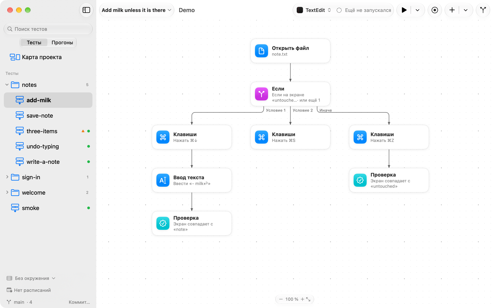
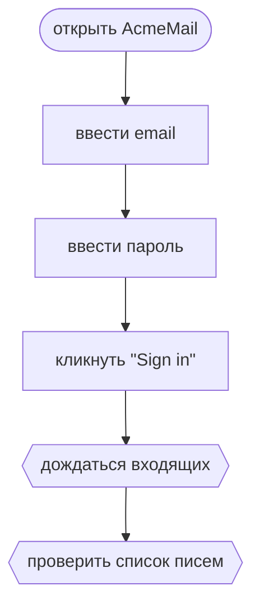

<p align="center"></p>
<h1 align="center">JEVision</h1>
<p align="center"><b>Тесты интерфейса, которые видно.</b><br>Нарисуйте путь пользователя по любому приложению на Mac. JEVision пройдёт его блок за блоком и покажет, где он сломался.</p>
<p align="center"><sub><a href="../../README.md">English</a> · <b>Русский</b></sub></p>

<p align="center">
<picture>
<source media="(prefers-color-scheme: dark)" srcset="../media/hero-ru-dark.png">

</picture>
</p>

JEVision тестирует интерфейс любого приложения на Mac, в том числе чужих приложений, в код
которых нельзя ничего встроить. Он видит экран и пользуется настоящими мышью и клавиатурой, как
человек. Тест — это блок-схема: один JSON-файл на тест и по блоку на каждый шаг. Поэтому его может
прочитать любой в команде, а провал указывает на блок, где он произошёл.

## Как получить JEVision

Для JEVision нужна macOS 26 или новее, на Apple silicon или Intel. До первого релиза
соберите его из исходников. Для этого нужны Xcode 26 или новее и Rust 1.85 или новее,
установленный через [rustup](https://rustup.rs):

```sh
git clone https://github.com/dev-pikapik/JEVision.git
cd JEVision
apps/macos/scripts/build.sh
open apps/macos/build/JEVision.app
```

`build.sh` собирает ядро на Rust для обеих архитектур, а затем приложение и инструмент `jevision`
в `apps/macos/build/JEVision.app`. Задайте `ARCHS=arm64`, чтобы собрать только для одной
архитектуры, и `SIGN_IDENTITY`, чтобы подписать своим сертификатом вместо ad-hoc-подписи.

## Возможности

<table>
<tbody><tr>
<td width="50%" valign="top">
<picture><source media="(prefers-color-scheme: dark)" srcset="../media/editor-dark.png"></picture>
<br><b>Собирается из простых блоков</b>
<br>Пробел открывает библиотеку блоков: у каждого значок и строка о том, что он делает. Правый клик по холсту ставит блок прямо там.
</td>
<td width="50%" valign="top">
<picture><source media="(prefers-color-scheme: dark)" srcset="../media/branches-dark.png"></picture>
<br><b>Несколько путей</b>
<br>Блок «Если» проверяет несколько условий по порядку. Срабатывает первое, которому соответствует экран, а «Иначе» забирает остальное.
</td>
</tr></tbody>
<tbody><tr>
<td width="50%" valign="top">
<picture><source media="(prefers-color-scheme: dark)" srcset="../media/command-palette-dark.png"></picture>
<br><b>Всё в одном ⌘K</b>
<br>Наберите пару букв любой команды, блока или теста и нажмите Return.
</td>
<td width="50%" valign="top">
<picture><source media="(prefers-color-scheme: dark)" srcset="../media/report-dark.png"></picture>
<br><b>Видно, что сломалось</b>
<br>Каждый прогон хранит снимок экрана на каждом шаге. Проверка показывает экран рядом с эталоном, одно поверх другого или только отличающиеся пиксели.
</td>
</tr></tbody>
<tbody><tr>
<td width="50%" valign="top">
<picture><source media="(prefers-color-scheme: dark)" srcset="../media/history-dark.png"></picture>
<br><b>Все тесты разом и история</b>
<br>Запустите все тесты проекта сразу. История показывает, что прошло, что упало и какие тесты нестабильны, с доказательствами.
</td>
<td width="50%" valign="top">
<picture><source media="(prefers-color-scheme: dark)" srcset="../media/ai-check-dark.png"></picture>
<br><b>Проверки по смыслу</b>
<br>Когда сравнение картинок слишком строгое, опишите экран словами, например «В корзине 2 товара», и решение примет модель ИИ по вашему выбору.
</td>
</tr></tbody>
<tbody><tr>
<td width="50%" valign="top">
<picture><source media="(prefers-color-scheme: dark)" srcset="../media/git-dark.png"></picture>
<br><b>Git без терминала</b>
<br>Коммит по ⌥⌘C, пул-реквест по ⌥⌘P. Изменённый тест показан одной блок-схемой с добавленными, удалёнными и изменёнными блоками.
</td>
<td width="50%" valign="top">
<picture><source media="(prefers-color-scheme: dark)" srcset="../media/schedule-dark.png"></picture>
<br><b>Прогоны по расписанию</b>
<br>Каждую ночь, по будням или раз в несколько часов, в выбранном окружении. Если прогон упал, придёт уведомление.
</td>
</tr></tbody>
<tbody><tr>
<td width="50%" valign="top">
<picture><source media="(prefers-color-scheme: dark)" srcset="../media/project-map-dark.png"></picture>
<br><b>Карта проекта</b>
<br>Все тесты проекта на одной странице: последний результат, нестабильные тесты и тесты в карантине.
</td>
<td width="50%" valign="top">
<picture><source media="(prefers-color-scheme: dark)" srcset="../media/iphone-dark.png"></picture>
<br><b>Пульт на iPhone</b>
<br>Свяжите iPhone с Mac, запустите тест или одну строку его данных и следите за прогоном блок за блоком. Тесты и картинки остаются на Mac.
</td>
</tr></tbody>
</table>

А также: [командная строка `jevision`](#command-line) для Терминала и CI,
[ИИ-ассистенты через MCP](#assistants-mcp), [тесты с данными](#data-driven-tests) из CSV-файлов,
[окружения](#environments), [свои блоки](#custom-blocks), которыми можно делиться, и прогоны [в виртуальной машине](#in-a-virtual-machine).

## Первые шаги

1. Выберите **Открыть проект…** (⌘O) и укажите папку. Тесты — это файлы `*.flow.json` в ней.
   Удобно держать по папке на каждое приложение.
2. Выберите **Новый тест…** (⌘N), дайте тесту название и выберите приложение, которое нужно
   протестировать.
3. Нажмите **Записать** (⇧⌘R) и поработайте в приложении. Чтобы закончить, дважды нажмите Esc
   или нажмите **Готово**. Шаги появятся на холсте.
4. Нажмите **Запустить** (⌘R). Тестируемое приложение выйдет на передний план, и JEVision
   повторит шаги. Когда прогон закончится, откройте его отчёт: там видны все шаги со снимками
   экрана.

⌘K открывает палитру команд: наберите пару букв любой команды, блока или теста и нажмите
Return.

## Подробности

<a id="permissions"></a>
<details>
<summary><b>Разрешения</b></summary>

JEVision запрашивает два разрешения в разделе «Системные настройки → Конфиденциальность и
безопасность» и перед каждым запросом объясняет, зачем оно нужно:

- **Запись экрана и системного аудио** — чтобы делать снимки тестируемого приложения: находить,
  куда кликнуть, дожидаться нужных экранов и сравнивать их с эталонами.
- **Универсальный доступ** (начиная с macOS 27 — **Управление устройством и доступ к данным**) —
  чтобы кликать, вводить текст и нажимать клавиши за вас. Во время записи оно нужно, чтобы читать
  названия элементов управления: так у блоков и картинок появляются понятные имена. А ещё — чтобы
  замечать ваши мышь и клавиатуру: когда вы берёте управление на себя, прогон встаёт на паузу.

Раздел «Настройки → Разрешения» показывает, что уже разрешено, и открывает нужную страницу
Системных настроек.

</details>

<a id="how-it-works"></a>
<details>
<summary><b>Как устроен тест</b></summary>

Тест — это граф из блоков. Выполнение начинается с `start` и идёт по стрелкам.



Тот же тест в виде файла — [`examples/sign-in.flow.json`](../../examples/sign-in.flow.json), в
сокращении:

```json
{
  "format": 1,
  "name": "Sign in with valid credentials",
  "app": "com.example.AcmeMail",
  "start": "open",
  "blocks": {
    "open": { "type": "openApp", "next": "email" },
    "email": { "type": "type", "text": "demo@example.com", "into": { "image": "refs/email-field.png" }, "next": "password" },
    "password": { "type": "type", "text": "${secret.ACME_PASSWORD}", "into": { "image": "refs/password-field.png" }, "next": "submit" },
    "submit": { "type": "click", "target": { "image": "refs/sign-in-button.png" }, "button": "left", "next": "inbox" },
    "inbox": { "type": "waitFor", "until": { "appears": { "image": "refs/inbox.png" } }, "timeout": "10s", "next": "messages" },
    "messages": { "type": "check", "reference": { "image": "refs/message-list.png", "compare": "similar", "threshold": 0.9 } }
  }
}
```

- **`format`** — версия формата файла. Старые файлы обновляются при чтении. Файлы от более новой
  версии JEVision отклоняются, чтобы не прочитать их неправильно.
- **`app`** — идентификатор пакета (bundle identifier) тестируемого приложения.
- **Пути** (к эталонам, файлам данных, другим тестам) указываются относительно папки файла теста.
- **Секреты никогда не хранятся в файле.** `${secret.NAME}` ссылается на секрет по имени. Его
  значение берётся во время прогона из переменной окружения или из Связки ключей. `${env.NAME}` —
  значение выбранного окружения (см. ниже). `${data.COLUMN}` — значение из текущей строки таблицы
  `useData`. Все три можно использовать в тексте блока `type`.
- **Стрелки** — это `next`, `then`/`else` и `body`. Цикл возможен только через `body` блоков
  `repeat` и `useData`. Любой другой цикл считается ошибкой.
- **Необязательные метаданные** (карточка теста): `description`, `testType` (`smoke`,
  `regression`, `acceptance`), `priority` (`critical`, `high`, `medium`, `low`), `status`
  (`draft`, `ready`, `outdated`), `tags`, `preconditions` (предусловия), `author` (автор),
  `platform` (платформа), `link` (веб-адрес задачи или требования, начинается с `https://`),
  `flaky` (`true` — тест иногда падает по причинам вне приложения) и `retries` (сколько ещё раз
  запускать тест, если он упал; если не указано, действует значение проекта по умолчанию, см. ниже).
- **`canvas`** (необязательно) хранит вид теста в редакторе: `positions` блоков, передвинутых
  вручную, `sections` (рамки с заголовком вокруг части теста) и `notes` (текст в Markdown с автором,
  временем и рамкой; по желанию — о чём заметка: о тесте, папке или блоке, — прикреплённые файлы и
  ссылки, ответы и отметка «решено»). На выполнение теста он не влияет. Без него блоки
  раскладываются автоматически. Файлы заметок лежат рядом с тестом в `<тест>.assets/notes/<id заметки>/`.

</details>

<a id="environments"></a>
<details>
<summary><b>Окружения</b></summary>

Один тест можно запускать на тестовом стенде, в продакшене или на локальном сервере. Значения,
которые между ними отличаются, например адрес сервера или имя пользователя, хранятся в файле
`jevision.environments.json` в папке проекта, рядом с тестами, и коммитятся вместе с ними:

```json
{
  "format": 1,
  "default": "staging",
  "environments": {
    "production": { "BASE_URL": "https://example.com" },
    "staging": { "BASE_URL": "https://staging.example.com", "USER": "qa" }
  }
}
```

- Имена окружений состоят из букв, цифр, `-` и `_`. Имена значений — из букв, цифр и `_`.
- `default` необязателен и должен называть одно из окружений. Его используют `jevision run` без
  `--env` и запуск ассистентом без `env`. Приложение выбирает его, пока вы не выберете другое.
- Тест читает значение как `${env.BASE_URL}` — в тексте для ввода, а также в путях и адресах
  файлов, которые блок открывает или читает (там же работают `${secret.NAME}` и `${data.COLUMN}`).
  `jevision validate` и редактор сообщают об имени, которого нет ни в одном окружении, как об
  ошибке, а об имени, которое есть только в некоторых, — как о предупреждении.
- Файл не предназначен для секретов. Но и секрет может зависеть от окружения: приложение
  сохраняет его в Связке ключей для того окружения, которое выбрано, когда вы его задаёте. Во
  время прогона секрет берётся из переменной окружения `NAME`, затем из записи Связки ключей для
  выбранного окружения, затем из записи, общей для всех окружений.
- В приложении окружение выбирается внизу боковой панели или в меню запуска. Там же выбирается
  одна строка данных (или все) и число повторов для следующих прогонов. Выбранное окружение
  запоминается для каждого проекта на этом Mac. Перед прогоном приложение перечисляет имена
  недостающих значений и секретов, но не сами значения. В отчёте указано, в каком окружении шёл
  прогон.

</details>

<a id="data-driven-tests"></a>
<details>
<summary><b>Тесты с данными</b></summary>

Один тест можно прогнать с разными наборами значений, например для нескольких пользователей или
языков. Сложите значения в CSV-файл рядом с тестом, по строке на набор и по столбцу на значение,
и прочитайте его блоком `useData`. Блок после него получает значение из текущей строки как
`${data.COLUMN}`:

```csv
name,email,password
Anna,anna@example.com,first-try
Bo,bo@example.com,"quotes ""inside"", and a comma"
```

- **По разу на строку.** Первый блок `useData` на пути от `start` задаёт таблицу теста: весь тест
  проходит один раз для каждой её строки, и каждый блок теста читает значения этой строки. Каждая
  строка — отдельный результат со своими повторами. Он назван по столбцу `name` (регистр не
  важен), а если такого нет — по первому столбцу, например «Строка 2: Bo». Прогон успешен, когда
  прошли все строки. Отчёт и итог прогона показывают, сколько их прошло, например «Прошли 4 из 5
  строк». В JUnit XML каждая строка — отдельный тест-кейс, например `Sign in [Row 2: Bo]`.
  Таблица, в пути к которой есть подстановка, и любой следующий блок `useData` вместо этого
  проходят по своим строкам внутри прогона.
- **Выбор строк.** По умолчанию запускаются все строки. Одну строку или диапазон можно запустить
  через `jevision run --row 3` или `--rows 2-4`, через меню запуска в приложении или параметром
  `rows` в `run_test` у ассистента. Строки считаются с 1, строка заголовка не считается. Если
  указанной строки в таблице нет, прогон останавливается, не начавшись.
- **Правила CSV** ([RFC 4180](https://www.rfc-editor.org/rfc/rfc4180)). Первая строка задаёт
  названия столбцов: каждое должно быть заполнено и отличаться от остальных. Значения разделяются
  `,`, `;` или табуляцией — тем знаком, который чаще встречается в первой строке. Значение с
  разделителем, кавычкой или переводом строки заключается в двойные кавычки, а кавычка внутри
  пишется дважды (`""`). В каждой строке столько же значений, сколько в заголовке; значение может
  быть пустым. Пустые строки пропускаются. Кодировка файла — UTF-8, с меткой порядка байтов или
  без неё, концы строк — LF или CR LF.
- **Проверки.** `jevision validate` и редактор сообщают о таблице, которая нарушает эти правила,
  с номером строки, где ошибка. И о `${data.COLUMN}`, которого в таблице нет, — с перечнем
  столбцов, которые в ней есть.
- **Редактирование.** В приложении выберите блок `useData` и нажмите **Изменить данные…**, чтобы
  посмотреть таблицу, изменить ячейки, добавить или удалить строки и столбцы. Сохранение не меняет
  разделитель, концы строк и метку порядка байтов файла.

</details>

<a id="retries-flaky-tests-and-quarantine"></a>
<details>
<summary><b>Повторы, нестабильные тесты и карантин</b></summary>

Настройки, общие для всех тестов проекта, хранятся в `jevision.project.json` в папке проекта и
коммитятся вместе с тестами. Приложение записывает этот файл из «Настройки › Дополнительно» и из
боковой панели. Файл необязателен:

```json
{
  "format": 1,
  "retries": 2,
  "quarantine": [
    { "test": "checkout/pay.flow.json", "reason": "Payment sandbox is down, issue #42", "until": "2026-11-03" }
  ],
  "suggestQuarantineAfter": 3,
  "localOnly": true,
  "hide": [{ "x": 0.7, "y": 0, "width": 0.3, "height": 0.08 }]
}
```

- **Повторы.** Упавший тест запускается снова, но не больше заданного числа повторов. Сначала
  берётся `jevision run --retries`, затем `retries` самого теста, затем `retries` проекта, а иначе
  повторов нет. Не больше 10.
- **Вердикт.** Каждый прогон сообщает, как прошли повторы: тест прошёл с повтора после провала
  (тест нестабилен), каждый раз падал по-разному (возможно, нестабилен) или падал каждый раз
  подряд (настоящая ошибка, а не нестабильность). Эту строку показывают отчёт, приложение и
  `jevision run`.
- **Нестабильность по истории.** Если один и тот же файл теста, не менявшийся с тех пор (тот же
  хеш содержимого), за последние 30 дней в одном окружении и проходил, и падал, приложение
  помечает его как нестабильный в боковой панели, на карте проекта и в истории прогонов. Даты и
  количество прогонов служат доказательством. Тест с данными оценивается по строкам: отчёты
  хранят, какая строка шла (номер, подпись и отпечаток значений, но не сами значения), поэтому
  строка, которая иногда падает, нестабильна, а остальные нет.
- **Подсказка про карантин.** Прогон ненадёжен, если прошёл только с повтора или упал после того,
  как тот же неизменный тест проходил (серия падений считается один раз). Тест или строка данных,
  ненадёжные 3 раза за 7 дней, получают отметку в боковой панели; в карточке перечислены эти
  прогоны со ссылками на отчёты, а одна кнопка отправляет тест в карантин на 14 дней. Число
  меняется через `suggestQuarantineAfter` (от 1 до 10) или в «Настройки › Дополнительно».
- **Карантин.** В `quarantine` перечислены тесты (пути относительно папки проекта), провалы
  которых никому не должны мешать, пока их чинят. Они по-прежнему запускаются, и их отчёты
  показывают провал. Но провал не делает провальными «Запустить все» и код выхода `jevision run`,
  а в отчёте JUnit тест отмечен как пропущенный, с причиной и описанием провала. `reason`
  необязателен. `until` — последний день, `YYYY-MM-DD`: приложение предлагает 14 дней, можно выбрать
  другой или не задавать. На следующий день тест снова учитывается сам, ничего править не нужно.
  Боковая панель, карта проекта и отчёты помечают такие тесты («в карантине до 3 ноя»). Чтобы отправить тест
  в карантин или вернуть из него, используйте его меню в боковой панели, карточку теста или
  «Настройки › Дополнительно». `jevision run --include-quarantined-failures` учитывает их провалы
  как любые другие, например в ночной сборке.
- **Только модели на этом Mac.** `localOnly: true` оставляет снимки экрана проекта на Mac у всех,
  кто запускает его тесты, какими бы ни были их собственные настройки. Проверки по смыслу работают
  только с локальными моделями, а ассистенты не получают снимков. Включается в «Настройки → ИИ».
- **Всегда скрытые области.** В `hide` перечислены части окна (в долях от 0 до 1, как области
  блока), которые закрашиваются на каждом снимке экрана проекта, прежде чем он попадёт к модели
  ИИ или ассистенту. Например, имя учётной записи в углу каждого экрана.

`jevision fmt` переписывает файлы тестов в каноническом виде (см. [Командная строка](#command-line)).
В каноническом виде ключи идут в фиксированном порядке, блоки перечислены в порядке чтения,
выключенные и пустые настройки опущены. А `button` клика, `compare` эталона (с `threshold` для
`similar`) и `timeout` блока `waitFor` пишутся всегда. Поэтому любое изменение видно в diff как
небольшая понятная правка.

</details>

<a id="block-types"></a>
<details>
<summary><b>Типы блоков</b></summary>

| Блок | Группа | Что делает |
| --- | --- | --- |
| `openApp` | действия | Открывает тестируемое приложение или другое приложение по идентификатору пакета |
| `openFile` | действия | Открывает файлы или веб-адреса, по желанию в новом экземпляре приложения |
| `click` | действия | Кликает по картинке на экране, по элементу, описанному словами (его находит JEV), по точке или по середине области (`area`), левой, правой или средней кнопкой, одним или двойным кликом, по желанию с зажатыми ⌃ ⌥ ⇧ ⌘ (`"modifiers": ["cmd"]`). С `"waitForChange": true` затем ждёт до 10 секунд, пока экран изменится, и падает, если этого не произошло |
| `hover` | действия | Наводит указатель на картинку на экране, на элемент, описанный словами, на точку или область и оставляет его там — чтобы показать подсказку или меню, которое открывается при наведении; по желанию с зажатыми ⌃ ⌥ ⇧ ⌘ (`modifiers`) |
| `drag` | действия | Нажимает левую, правую или среднюю кнопку (`button`) на одной картинке, описанном элементе, точке или области (`from`), ведёт с зажатой кнопкой и отпускает на другой (`to`); по желанию с зажатыми ⌃ ⌥ ⇧ ⌘ (`modifiers`) |
| `scroll` | действия | Крутит колесо прокрутки `up`, `down`, `left` или `right` на `amount` строк (`lines`) или пикселей (`pixels`) — над серединой окна или над картинкой, описанным элементом, точкой либо областью (`at`); по желанию с зажатыми ⌃ ⌥ ⇧ ⌘ (`"modifiers": ["cmd"]` в большинстве приложений меняет масштаб) |
| `type` | действия | Вводит текст, по желанию в поле, найденное по картинке или описанию |
| `pressKeys` | действия | Нажимает сочетание клавиш, например `cmd+shift+s` |
| `waitFor` | ожидание и проверки | Ждёт, пока картинка появится, исчезнет или экран перестанет меняться |
| `check` | ожидание и проверки | Сравнивает экран с эталоном, точно или по сходству, либо проверяет его по смыслу |
| `if` | логика | Переходит к `then` или `else` в зависимости от того, что на экране |
| `repeat` | логика | Выполняет свой `body` заданное число раз |
| `runTest` | логика | Запускает другой файл теста или [свой блок](#custom-blocks) как шаг; его `inputs` задают значения для `${input.NAME}` в том тесте |
| `useData` | данные | Выполняет свой `body` для строк CSV-файла (см. [Тесты с данными](#data-driven-tests)) |
| `script` | данные и система | Запускает скрипт на `sh`, `zsh`, Python 3, Node или AppleScript; входы (`inputs`) — текст, число, логическое значение, картинка (PNG-файл) или область (`x,y,width,height` в долях окна), выходы (`outputs`) становятся `${var.NAME}` тех же типов; значение, не подходящее по типу, находится ещё при редактировании |
| `clipboard` | данные и система | Кладёт в буфер обмена текст или PNG-картинку (`put`), сохраняет в переменную его текст, картинку (`"content": "image"`) или скопированные файлы (`"content": "files"`) (`read`) или ждёт, пока он станет равен значению, будет его содержать или сравнится с ним (`check`); тест с этим блоком не идёт параллельно с другим тестом, который использует экран |
| `dateTime` | данные и система | Сохраняет текущие дату и время в формате `strftime` (`format`), сдвинутые на `shift`, например `{ "amount": -2, "unit": "days" }`, как `${var.NAME}`; названия месяцев и дней — по-английски или по-русски (`language`), время — в часовом поясе Mac или другом (`"timeZone": "Europe/Berlin"`) |

Эталон может ограничить сравнение областью `area`, не учитывать (`ignore`) участки, которые
меняются сами по себе, и скрывать (`hide`) участки, которые не должны попадать в отчёты. Области
задаются в долях окна, от 0 до 1.

Когда тестируемое приложение отображается в тёмном оформлении, прогон использует тёмную версию
картинки. В её имени перед расширением стоит `.dark`: `refs/inbox.dark.png` для `refs/inbox.png`.
Блок `check` сохраняет её при первом прогоне в тёмном оформлении, как любой новый эталон. `waitFor`,
`if` и цели кликов используют её, если она есть, а иначе — светлую картинку. В файле теста указана
только светлая картинка.

С `"compare": "meaning"` модель ИИ смотрит на экран и решает, показывает ли он то, что простыми
словами сказано в `expect`: `{ "compare": "meaning", "expect": "The cart shows 2 items" }`.
Эталон необязателен. Если он есть, модель сравнивает экран с ним. Такой эталон принимают `check`,
`waitFor` и `if`.

</details>

<a id="custom-blocks"></a>
<details>
<summary><b>Свои блоки</b></summary>

Свой блок — это тест, который другие тесты запускают через `runTest`. Значения приходят через
`inputs`, а блок читает их как `${input.NAME}`. Выделите блоки на холсте и выберите **Сделать
блок…**: он ляжет в `blocks/` проекта и появится в библиотеке блоков.

Чтобы поделиться блоком, откройте **Файл → Свои блоки…** и нажмите **Поделиться…** рядом с ним.
JEVision запишет пакет — папку `com.author.name.jevblock/` с `block.json` (id, название, описание,
значок, версия, автор, лицензия, нужные входы), `flow.json` с шагами и картинками, которые они
используют, — папкой или .zip-файлом. Положите его в репозиторий или релиз на GitHub.

Чтобы поставить чужой блок, выберите **Файл → Установить блок…**, перетащите папку или .zip-файл
в окно либо вставьте https-адрес; если в папке, репозитории или релизе несколько блоков, они придут
списком, из которого можно выбрать. Перед установкой лист простыми словами объяснит, что делает блок,
и отметит скрипты, сетевые запросы, запросы к базам, открытие приложений и ввод с клавиатуры, чтобы
вы знали, что пускаете в проект. Установленные блоки появляются в библиотеке в группе **Сообщество**
с автором и версией, а отчёты называют пакет и его версию. **Обновить** берёт новую версию блока,
установленного по адресу, а **Убрать** называет тесты, которые ещё используют блок, и не удаляет
его молча. Блок может запускать другие блоки, перечисленные в `dependencies`, — они ставятся первыми.
Установленные блоки только для чтения: **Сделать своим блоком проекта** копирует блок в ваши блоки,
где его можно менять. При открытии проекта JEVision предложит поставить блоки из
`jevision.blocks.json`, которых нет на этом Mac.

```sh
jevision blocks list                      # блоки, установленные в проекте
jevision blocks install ./sign-in.zip     # показать, что делает блок; --yes — установить
jevision blocks install https://github.com/acme/sign-in --yes
jevision blocks update                    # новая версия каждого блока, установленного по адресу
jevision blocks remove com.acme.sign-in   # --force, если блок используют тесты
jevision blocks restore --yes             # поставить то, что есть в jevision.blocks.json, но нет в проекте
```

Установка ничего не запускает, а распаковка не выходит за папку проекта. Формат описан в
[docs/custom-blocks.html](../custom-blocks.html), пример пакета — в
[examples/textedit/blocks](../../examples/textedit/blocks).

</details>

<a id="ai-models"></a>
<details>
<summary><b>Модели ИИ</b></summary>

Проверки по смыслу используют модель, выбранную в «Настройки → ИИ». Если модель не выбрана,
JEVision только сравнивает картинки и никуда ничего не отправляет.

| Провайдер | Где работает | API-ключ |
|---|---|---|
| Anthropic | в облаке | `ANTHROPIC_API_KEY` |
| OpenAI | в облаке | `OPENAI_API_KEY` |
| Google Gemini | в облаке | `GEMINI_API_KEY` |
| Ollama | на этом Mac | не нужен |
| LM Studio | на этом Mac | не нужен |
| Сервер, совместимый с OpenAI | по указанному вами адресу | `OPENAI_COMPATIBLE_API_KEY`, если сервер его требует |

- **Что отправляется.** Для каждой проверки по смыслу: сравниваемая часть экрана, эталон, если он
  есть, и ожидаемый текст. Для каждого элемента, описанного в тесте словами: снимок окна и описание —
  в JEV. Больше ничего не отправляется.
- **Поиск по описанию.** `click`, `hover`, `drag`, `scroll` или `type` может указывать на элемент,
  описанный словами, например `{ "description": "the blue Save button" }`. Его находит JEV на
  закрашенном снимке экрана, а отчёт обводит найденное место, поэтому
  JEV нужно настроить здесь, даже если проверки по смыслу делает другой провайдер; нужна модель
  jev-1.14.0 или новее либо jev-latest.
- **Закрашивание.** Прежде чем картинка покинет Mac, сплошные серые прямоугольники закрывают
  области, которые эталон скрывает или не учитывает, области `hide` проекта и все поля паролей,
  которые JEVision может найти благодаря разрешению «Универсальный доступ». Отчёт показывает
  картинку ровно в том виде, в каком она была отправлена, с пометкой «закрашено перед отправкой».
  Снимки экрана для ассистентов закрашиваются так же.
- **API-ключи** берутся из переменной окружения, указанной в таблице, или из Связки ключей, куда
  их сохраняет раздел «Настройки → ИИ». Они никогда не показываются, не пишутся в журналы и не
  попадают в отчёты.
- **Только модели на этом Mac.** Когда этот параметр включён, снимки экрана никогда не уходят в
  облачный сервис: проверка, которой он нужен, останавливается с сообщением. Проект может
  потребовать этого от всех через `localOnly` в `jevision.project.json`.
- **Отчёты** хранят провайдера, модель и её объяснение для каждой проверки по смыслу.
- **Проверить подключение** в настройках задаёт модели вопрос о небольшой встроенной картинке,
  чтобы разом проверить адрес, ключ и модель.

</details>

<a id="command-line"></a>
<details>
<summary><b>Командная строка</b></summary>

Команда `jevision` запускает и проверяет тесты из Терминала, скриптов и CI. Она входит в
приложение: выберите **JEVision → Установить инструмент командной строки…** и нажмите
**Установить…**. macOS запросит пароль администратора и создаст ссылку на инструмент в
`/usr/local/bin`. Если пароля нет, нажмите **Установить только для меня**, и ссылка появится в
`~/.local/bin`. Окно показывает, установлен ли инструмент и какой версии.

```sh
jevision run tests/                       # запустить все *.flow.json в tests/ и сохранить отчёты
jevision run tests/sign-in.flow.json --start-at submit
jevision run tests/ --project ~/ui-tests  # папка проекта (по умолчанию ближайшая папка с .jevision)
jevision run tests/ --retries 2           # запускать упавший тест ещё до 2 раз
jevision run tests/ --env staging         # брать ${env.NAME} из окружения staging
jevision run tests/sign-in.flow.json --rows 2-4   # только строки 2–4 таблицы данных (--row 3 для одной)
jevision run tests/ --junit junit.xml --html reports    # также сохранить отчёты JUnit XML и HTML
jevision run tests/ --video always        # записывать видео каждого прогона (off, on-failure, always)
jevision run tests/ --parallel 4          # до 4 тестов сразу; те, что трогают экран, идут по очереди
jevision run tests/ --include-quarantined-failures   # учитывать и провалы тестов в карантине
jevision run tests/ --priority critical --type smoke  # только тесты с такой карточкой (есть и --status, --author, --flaky)
jevision run tests/ --provider ollama --model qwen2.5vl:7b   # проверка по смыслу другой моделью
jevision run tests/ --json                # вывести результаты в JSON; ход прогона идёт в stderr
jevision validate tests/                  # сообщить об ошибках и предупреждениях (--json для программ)
jevision fmt tests/                       # переписать файлы в каноническом виде (--check — только сообщить)
jevision blocks list                      # свои блоки, установленные в проекте (ещё install, update, remove)
jevision schedule run ~/Projects/AcmeMail # выполнить расписания проекта, время которых пришло
jevision --version                        # вывести версию (кратко -V)
```

`jevision help <command>` перечисляет все параметры. Код выхода: **0** — все тесты прошли (или все
файлы корректны и отформатированы); тесты в карантине при этом могли упасть (см.
[Повторы, нестабильные тесты и карантин](#retries-flaky-tests-and-quarantine)). **1** — тест упал
или был остановлен либо в файле есть проблемы. **2** — неверные аргументы, файл не читается или
Mac сейчас не может запускать тесты.

`jevision run` работает с настоящими мышью, клавиатурой и экраном. Где бы он ни запускался,
действуют такие требования:

- **Пользователь вошёл в систему, экран не заблокирован.** Тесты нельзя запускать как системную
  службу или при заблокированном экране. По SSH они запускаются только от имени пользователя,
  который вошёл в систему за этим экраном, и разрешения ниже должны быть выданы
  `/usr/libexec/sshd-session` (см. [В виртуальной машине](#in-a-virtual-machine)). Для прогонов
  без присмотра не выходите из системы и выключите автоматическую блокировку в «Системные
  настройки → Экран блокировки».
- **Запись экрана и системного аудио и Универсальный доступ** (начиная с macOS 27 — Управление
  устройством и доступ к данным) для приложения, которое запускает `jevision`: Терминала, вашего
  редактора или агента CI. Если разрешения нет, `jevision` назовёт программу, которой оно нужно,
  и список в «Системные настройки → Конфиденциальность и безопасность», где его включить.
- **Секреты** (`${secret.NAME}`) берутся из переменной окружения `NAME` или из Связки ключей, куда
  их сохраняет приложение. Когда `jevision` впервые читает секрет из Связки ключей, macOS может
  запросить разрешение. Для прогонов без присмотра выберите «Всегда разрешать». Значения никогда
  не выводятся. С `--env` сначала проверяется запись Связки ключей для этого окружения (см.
  [Окружения](#environments)).
- **Модели ИИ** для проверок по смыслу — те, что выбраны в приложении в «Настройки → ИИ», если
  `--provider` и `--model` не задают другие. API-ключи берутся из тех же переменных окружения или
  из Связки ключей.

Чтобы остановить прогон, дважды нажмите Esc или нажмите Ctrl-C. Остановленный тест будет отмечен в
отчёте как отменённый.

</details>

<a id="github-actions"></a>
<details>
<summary><b>GitHub Actions</b></summary>

У раннеров, которые размещает GitHub, нет пользователя, вошедшего в систему, поэтому используйте
[собственный раннер (self-hosted runner)](https://docs.github.com/actions/hosting-your-own-runners)
на Mac. Установите его как службу командой `./svc.sh install`, войдя в систему под тем
пользователем, от имени которого идут тесты. В macOS это создаёт агент запуска (launch agent),
который работает в сеансе этого пользователя. Затем разрешите «Запись экрана и системного аудио» и
«Универсальный доступ» (начиная с macOS 27 — «Управление устройством и доступ к данным») для
программы, которую назовёт первый прогон.

```yaml
jobs:
  ui-tests:
    runs-on: [self-hosted, macOS]
    steps:
      - uses: actions/checkout@v4
      - name: Run UI tests
        env:
          ACME_PASSWORD: ${{ secrets.ACME_PASSWORD }}
        run: jevision run tests --junit junit.xml --html reports
      - uses: actions/upload-artifact@v4
        if: always()
        with:
          name: jevision-reports
          include-hidden-files: true
          overwrite: true
          path: |
            junit.xml
            reports/
            tests/.jevision/runs/
```

Набирать это не обязательно: **Настройки › Дополнительно › Непрерывная интеграция › Добавить в
проект…** показывает этот файл для открытого проекта, с секретами, которые используют ваши тесты,
и записывает его как `.github/workflows/jevision.yml` в корне git-репозитория, где лежит проект.
Сначала показывается предпросмотр, а существующий файл заменяется только после вашего
подтверждения. Ничего не коммитится и не отправляется.

Артефакт `jevision-reports` несёт и отчёты о прогонах со снимками экрана. Когда вы вошли в GitHub
(Настройки › Git и GitHub), а репозиторий проекта лежит на GitHub, приложение забирает самые
свежие из них при каждом открытии **Прогонов** и по кнопке обновления там же и добавляет в историю,
каждый ровно один раз. Прогон из CI помечен «CI · пул-реквест #482» или «CI · ветка main», его
отчёт ссылается на прогон на GitHub, а фильтр над списком показывает только такие. Без входа
ничего не загружается, и список говорит об этом. Артефакты старого workflow, без отчётов о
прогонах, требуют добавить workflow заново.

</details>

<a id="on-a-schedule"></a>
<details>
<summary><b>По расписанию</b></summary>

Чтобы тесты запускались сами, выберите **Тест → Расписания…** или нажмите строку расписания внизу
боковой панели. Запускать можно все тесты, тесты одной папки или выбранные тесты. Каждый день, в
выбранные дни недели или каждые 1, 2, 3, 4, 6, 8 или 12 часов начиная с заданного времени. С
окружением и режимом видео на ваш выбор. Окно показывает каждое расписание словами, время его
следующего запуска и то, чем закончился последний.

Расписания хранятся в `jevision.schedule.json` в папке проекта и коммитятся вместе с тестами:

```json
{
  "format": 1,
  "schedules": [
    { "name": "Nightly", "tests": "all", "repeat": "daily", "at": "03:00" },
    { "name": "Smoke", "tests": { "files": ["sign-in.flow.json", "mail/send.flow.json"] },
      "repeat": { "days": ["mon", "tue", "wed", "thu", "fri"] }, "at": "09:05",
      "environment": "staging", "video": "on-failure" },
    { "name": "Checkout", "tests": { "folder": "checkout" }, "repeat": { "everyHours": 6 },
      "at": "01:30" }
  ]
}
```

- `name` обязательно и должно быть уникальным в файле, без учёта регистра.
- `tests` — это `"all"`, `{ "folder": "path" }` или `{ "files": ["path", …] }`. Пути указываются
  относительно папки проекта и не выходят за её пределы.
- `repeat` — это `"daily"`, `{ "days": [...] }` с любыми из `sun`, `mon`, `tue`, `wed`, `thu`,
  `fri`, `sat` или `{ "everyHours": N }`, где N — одно из 1, 2, 3, 4, 6, 8, 12. `at` — местное
  время в виде `HH:MM`. Для `everyHours` это первый запуск за день, а остальные идут каждые N часов.
- `environment` (необязательно) называет окружение из `jevision.environments.json`. Без него
  используется окружение проекта по умолчанию. `video` (необязательно) — `off`, `on-failure` или
  `always`. Без него действует настройка приложения.

На Mac расписания начинают работать только после того, как вы сохраните их или нажмёте
**Включить** в окне расписаний на этом Mac. Тогда приложение устанавливает для проекта агент
запуска (`~/Library/LaunchAgents/io.github.dev-pikapik.jevision.schedule.<id>.plist`) и следит,
чтобы он соответствовал файлу. Агент запускает `jevision schedule run <project>` во время,
указанное в расписаниях. Команда выполняет все расписания, время которых пришло, один раз
навёрстывает прогон, пропущенный не более чем на 12 часов (если Mac был в режиме сна), и сохраняет
отчёты вместе с остальными прогонами. В истории прогонов приложения они помечены «Расписание». Итог
каждого прогона по расписанию хранится в `.jevision/schedule-history.json`.

Для прогонов нужен пользователь, вошедший в систему, и незаблокированный экран. Прогон, время
которого пришло при заблокированном экране, пропускается и записывается как «Пропущен: экран был
заблокирован». JEVision никогда не вводит текст на заблокированном экране. Для прогонов без
присмотра выключите автоматическую блокировку экрана. Если прогон по расписанию упал, был
пропущен или не смог начаться, приложение присылает уведомление. Если удалить все расписания,
агент запуска тоже удаляется.

</details>

<a id="in-a-virtual-machine"></a>
<details>
<summary><b>В виртуальной машине</b></summary>

Тесты можно запускать в виртуальной машине macOS на Mac с Apple silicon, созданной в
[Tart](https://tart.run), [UTM](https://mac.getutm.app) или другом инструменте на основе
виртуализации Apple. Тогда тесты кликают и вводят текст внутри виртуальной машины, ваш Mac остаётся
свободным, а каждый прогон может начинаться с чистой копии. Виртуальную машину достаточно
настроить один раз: установить в неё JEVision, разрешить внутри неё «Запись экрана и системного
звука» и «Универсальный доступ», включить автоматический вход и выключить блокировку экрана для
прогонов без присмотра. После этого запускайте прогоны в её окне, из раннера CI внутри неё или со
своего Mac по SSH:

```sh
ssh admin@192.168.64.5 /usr/local/bin/jevision run my-tests --junit junit.xml --html reports
```

У виртуальной машины часто обычный дисплей, а эталоны, сохранённые на Mac с дисплеем Retina, вдвое
больше. Клики и поиск картинок работают при любой плотности, а проверки масштабируют картинки. Но
проверка `exact` падает с сообщением, что эталон снят на дисплее другой плотности. Сохраняйте
эталоны в виртуальной машине или дайте ей дисплей Retina. Каждый отчёт записывает, где шёл прогон:
заголовок и HTML-отчёт показывают «Виртуальная машина» или «Физический Mac» и дисплей, например
«Обычный дисплей (1×)», а в `report.json` есть `virtualMachine` и `displayScale`.

Пошаговое руководство, с SSH, CI и ограничениями, например не больше двух виртуальных машин Apple
на один Mac: [docs/vm.html](../vm.html). Оно открывается и из приложения: **Настройки › Дополнительно
› Узнать больше**.

</details>

<a id="logs-crash-reports-and-the-example"></a>
<details>
<summary><b>Журнал, отчёты о сбоях и пример проекта</b></summary>

Всё это в **Настройки › Дополнительно** и остаётся на вашем Mac. Ничего никуда не отправляется.

- **Журнал.** JEVision записывает свои действия в `~/Library/Logs/JEVision`: открытие проекта,
  начало прогона и чем он закончился, а также то, что пошло не так. **Подробность журнала**:
  *Только ошибки*, *Обычно* (по умолчанию) или *Подробно* — с каждым шагом прогона. Журнал
  ротируется: он никогда не больше примерно 2 МБ, а самые старые строки удаляются. Секреты и
  набранный текст не записываются, а всё, что похоже на ключ, токен или пароль, скрывается.
  **Показать в Finder** открывает папку.
- **Отчёты о сбоях.** Выключены, пока вы не включите **Сохранять отчёты о сбоях**. Если JEVision
  аварийно завершится, macOS передаст ему отчёт при следующем запуске (MetricKit, до суток
  спустя), и JEVision сохранит последние 20 в
  `~/Library/Application Support/JEVision/Crash Reports`. Отчёт покидает ваш Mac, только если вы
  выбрали его в сообщении об ошибке: **Добавить отчёт о сбое** кладёт его краткое содержание в
  описание, где его можно прочитать и изменить перед отправкой.
- **Пример проекта.** **Открыть пример проекта** копирует готовый тест для TextEdit в выбранную
  вами папку и открывает копию. Пример внутри приложения никогда не меняется.

</details>

<a id="assistants-mcp"></a>
<details>
<summary><b>Ассистенты (MCP)</b></summary>

`jevision mcp` — сервер [Model Context Protocol](https://modelcontextprotocol.io) для ИИ-ассистентов
на том же Mac. Ассистент сам запускает его и общается с ним через стандартный ввод и вывод. Сеть
при этом никто не слушает. Добавьте его в список MCP-серверов ассистента. Раздел «Настройки → ИИ →
Ассистенты» в приложении показывает готовую конфигурацию с вашими путями, которую можно
скопировать:

```json
{
  "mcpServers": {
    "jevision": {
      "command": "/usr/local/bin/jevision",
      "args": ["mcp", "--project", "/Users/you/ui-tests"]
    }
  }
}
```

Без `--project` проектом считается ближайшая папка выше текущей, в которой есть папка `.jevision`,
а если такой нет — текущая папка.

| Инструмент | Что делает |
| --- | --- |
| `list_tests` | Перечисляет тесты проекта и ищет по ним, при желании по `testType`, `priority`, `status`, `author` или `flaky` |
| `read_test`, `write_test` | Читают файл теста или записывают его. Некорректные тесты не сохраняются, а для каждой проблемы указаны её блок и поле |
| `add_blocks`, `remove_block` | Меняют тест так же, как редактор |
| `validate_test` | Проверяет тест или папку с тестами |
| `list_block_types` | Описывает формат файла и все типы блоков, с примерами |
| `run_test`, `get_run`, `stop_run` | Запускают тест или папку (по желанию в окружении, `env`, и с частью строк таблицы данных, `rows`), ждут результата, останавливают прогон |
| `get_report` | Вердикт прогона, шаги, провалы, ответы модели ИИ и, по запросу, снимки экрана |
| `screenshot` | Переднее окно приложения в его текущем виде |

Безопасность:

- Запуск тестов и снимки экрана выключены, пока вы не включите их в «Настройки → ИИ →
  Ассистенты». Всё остальное только читает и записывает файлы тестов.
- Ассистенты видят тот же JSON, что и вы. Секреты остаются в тестах в виде `${secret.NAME}` и
  скрыты в отчётах. API-ключи провайдеров ИИ ассистентам недоступны.
- Снимки экрана из `screenshot` и `get_report` закрашиваются так же, как снимки для моделей ИИ. В
  проекте с `localOnly` или при включённом параметре «Только модели на этом Mac» ассистенты не
  получают снимков.
- Пути не выходят за пределы папки проекта: `..` и символические ссылки, ведущие наружу,
  отклоняются.
- Прогон, запущенный ассистентом, встаёт на паузу, пока вы пользуетесь мышью или клавиатурой, а
  двойное нажатие Esc его останавливает.

</details>

<a id="iphone-remote"></a>
<details>
<summary><b>Пульт на iPhone</b></summary>

JEVision Remote превращает iPhone в пульт для JEVision на вашем Mac. С ним можно просматривать
проекты и тесты каждого связанного Mac, видеть тест в виде блок-схемы с последними результатами,
запускать тест или одну строку его таблицы данных и следить за ним блок за блоком или останавливать его. А ещё читать отчёты с
короткой причиной каждого провала и просматривать историю прогонов проекта.

- **Связывание.** На Mac откройте «Настройки → iPhone и удалённо», включите **Разрешить удалённый
  доступ** и выберите, что сможет делать следующее устройство: **Может запускать** или **Только
  смотреть**. В приложении на iPhone нажмите **Связать с Mac**, отсканируйте код и подтвердите
  с помощью Face ID или код-пароля. Код действует один раз и в течение пяти минут.
- **Конфиденциальность.** Тесты, картинки и секреты остаются на Mac. iPhone хранит только список
  связанных Mac. Каждый iPhone входит со своим ключом из Secure Enclave по соединению со сквозным
  шифрованием, напрямую или через ретранслятор, который не может его прочитать. Mac показывает
  все подключённые iPhone и может сразу отозвать доступ любого из них.

Приложения пока нет в App Store. Соберите его из [`apps/ios`](../../apps/ios/README.md), там же
описано, как собрать его для Симулятора.

</details>

<a id="git"></a>
<details>
<summary><b>Git и GitHub</b></summary>

Тесты — это обычные файлы, поэтому их историю хранит git. Раздел «Настройки → Git и GitHub»
показывает ветку и изменения проекта. Их же показывает низ боковой панели, откуда открывается этот
раздел.

- **Коммит.** Отметьте изменения, которые нужно включить, и опишите их. В коммите только ваше
  сообщение: JEVision не добавляет ни трейлеров, ни подписей. Git один раз спросит ваше имя и
  адрес электронной почты.
- **Что изменилось.** Тест показан одной блок-схемой: добавленные блоки зелёные, удалённые —
  красные, изменённые — жёлтые, и для каждого изменённого блока видно, каким он был и каким стал.
  Картинки можно сравнить рядом, под передвижной шторкой, одну поверх другой или с отличающимися
  пикселями, выделенными красным.
- **История.** «Показать историю…» для теста или папки перечисляет коммиты, которые их меняли, с
  учётом переименований. «Вернуть эту версию» записывает файл таким, каким он был. «Правка →
  Отменить» отменяет это.
- **Получение, отправка и ветки.** «Получить» сливает коммиты с сервера. Если они затрагивают те
  же строки, что и ваши, ничего не меняется, а приложение называет файлы. «Отправить» отправляет
  на сервер и новую ветку.
- **Изменения ещё не отслеживаются.** «Отслеживать изменения» создаёт репозиторий.
- **Пул-реквесты.** Если репозиторий на GitHub, «Пул-реквесты → Новый…» предлагает текущую ветку
  с вашими заголовком и описанием (при необходимости сначала отправив её). Целевая ветка — ветка
  по умолчанию, если вы не выберете другую. «Показать…» перечисляет открытые пул-реквесты: для
  каждого видны тесты и картинки, которые он меняет, до и после, и его можно открыть на GitHub.

JEVision использует git, установленный на Mac (он входит в инструменты разработчика для командной
строки, Command Line Developer Tools). Поэтому вход на сервер работает так же, как в Терминале:
через GitHub CLI (`gh auth login`), Связку ключей или SSH-ключи. Для самого GitHub (аккаунт и
пул-реквесты) приложение использует вход GitHub CLI: оно запрашивает `gh auth token`, когда это
нужно, и никогда не хранит, не показывает и не передаёт токен. Собственного входа у приложения нет.

</details>

<a id="releasing"></a>
<details>
<summary><b>Выпуск релизов</b></summary>

Релизы выпускает мейнтейнер на Mac. Версия задаётся полем `version` в корневом `Cargo.toml` и
общая для ядра, приложения и инструмента `jevision`. Номер сборки — это число коммитов, поэтому
собирайте релизы из полного клона.

Настройка, один раз:

1. **Подпись.** Установите сертификат *Developer ID Application* в связку ключей «Вход» (login).
   Его покажет команда `security find-identity -v -p codesigning`.
2. **Нотаризация.** Создайте пароль для приложения на
   [appleid.apple.com](https://appleid.apple.com) и сохраните его как профиль в связке ключей:
   `xcrun notarytool store-credentials jevision --apple-id <Apple ID> --team-id <Team ID>`.
3. **Ключ обновлений.** Sparkle проверяет каждое обновление по паре ключей. Создайте её один раз.
   Закрытый ключ остаётся в связке ключей «Вход» (сделайте резервную копию командой
   `generate_keys --account jevision -x <file>`):
   `apps/macos/.build/artifacts/sparkle/Sparkle/bin/generate_keys --account jevision`
   (если этой папки нет, сначала выполните `swift package resolve --package-path apps/macos`).
   `release.sh` читает открытый ключ из связки ключей или из `SPARKLE_PUBLIC_ED_KEY`.
4. **Appcast.** Приложение ищет обновления по адресу `https://dev-pikapik.github.io/JEVision/appcast.xml`
   (`SUFeedURL` в `apps/macos/Resources/Info.plist`). Включите GitHub Pages для репозитория и
   опубликуйте `appcast.xml` в его корне. Пока этого файла нет, приложение просто не находит
   обновлений.
5. **Homebrew.** Создайте tap-репозиторий `dev-pikapik/homebrew-jevision` с папкой `Casks`.

Для каждого релиза:

```sh
# 1. Собрать, подписать, нотаризовать и прикрепить тикет (staple); получится apps/macos/build/JEVision-<version>.dmg
SIGN_IDENTITY="Developer ID Application: <Name> (<Team ID>)" NOTARY_PROFILE=jevision \
  apps/macos/scripts/release.sh
# 2. Appcast с новой версией, подписанный ключом обновлений (RELEASE_NOTES=notes.md, чтобы встроить заметки)
apps/macos/scripts/make-appcast.sh apps/macos/build/JEVision-<version>.dmg
# 3. Cask для Homebrew с новой версией и контрольной суммой
packaging/homebrew/update-cask.sh apps/macos/build/JEVision-<version>.dmg
```

Затем поставьте на коммит тег `v<version>`, приложите образ диска к релизу GitHub с этим тегом,
опубликуйте `apps/macos/build/appcast/appcast.xml` на GitHub Pages и скопируйте
`packaging/homebrew/jevision.rb` в папку `Casks/` tap-репозитория. Без `NOTARY_PROFILE` скрипт
`release.sh` останавливается после подписи, и этого достаточно, чтобы проверить сборку. `ADHOC=1`
собирает тот же образ диска вообще без сертификата, как это делает CI.

</details>

## Планы

- Тестирование приложений для iPhone в Симуляторе iOS
- GitHub в приложении: результаты прогонов в пул-реквестах, вход без GitHub CLI
- Windows и Linux, у каждой свой интерфейс

## Участие

Мы рады идеям, вопросам и пул-реквестам. Начните с [CONTRIBUTING.md](../../CONTRIBUTING.md)
и, пожалуйста, соблюдайте [Кодекс поведения](../../CODE_OF_CONDUCT.md).
Проблемы безопасности: см. [SECURITY.md](../../SECURITY.md).

## Лицензия

[MIT](../../LICENSE)
